# API conventions

## The three endpoints of a table

| Endpoint | Folder | Purpose |
|---|---|---|
| `POST v1/<group>/<name>/upsert` | `NN-upsert-<name>` | insert, update, delete or archive one row |
| `POST v1/<group>/<name>/upsert/batch` | `NN-upsert-<name>-batch` | the same for 1–100 rows in one transaction |
| `GET v1/<group>/<name>` | `NN-inquiry-<name>` | list or fetch rows |

Folder: `e-commerce/doc/api/<group>/<NN>-<name>/` with `spec.md` and `sequence.wsd` (the diagram, built from the spec with `scripts/sequence_skeleton.py` and finished by the author, see "Sequence diagram" below); the number continues the group's numbering. Not every table needs all three (a table the system fills itself has only an inquiry; a customer-owned row like a review has no batch). Say why in the spec when you leave one out.

## Upsert

- No `id` = insert. `id` = update. `rowStatus: "DELETED"` = soft delete. `rowStatus: "ARCHIVED"` = archive. Rows are never removed.
- HTTP: insert **201**, update **200**, delete **204 with no body**, archive **200**. **Batch always answers 200**, also when an item deletes; each item reports `index`, its id and `action` (`INSERT`, `UPDATE`, `DELETE`, `ARCHIVE`).
- `DELETED` is final: an id that is deleted counts as not found (404). `INACTIVE`, `LOCKED`, `ARCHIVED` can go back to `ACTIVE`. A request that inserts with `rowStatus` `DELETED` is a 400.
- Nested children (images, lots, members): without `id` = insert, with `id` = update, `rowStatus` `DELETED` = delete, children that are not listed are **kept**. The exception is a child list that defines a complete set (product option levels); say so in the spec and in the example.
- The caller (user) always comes from the access token, never from the body.
- Unchangeable fields (`shopId`, `userId`, parent keys) must be sent again on update and a different value is a 400.

## Batch

1–100 items, one transaction, all or nothing. Validate the whole request first (400, in item order), then existence (404), then permission (403), then conflicts (409), then write. Every error message starts with the position, `skus[2]: ...`. Check duplicate ids and duplicate unique values inside the request (400). A rule that depends on the final state (the last admin of a shop, a 100-line cart) is checked once after all items are applied.

## Inquiry

Query parameters: `id` (a list with one item), `pageIndex` (from 1, default 1), `pageSize` (default 10, max 100), `search` (ILIKE), plus the filters the screen needs. Rows with `DELETED` are never returned. The response is `data.<items>[]`, `pageIndex`, `pageSize`, `totalItems`, `totalPages`; nothing found is **200 with an empty list**, unless the thing asked for (a shop page) must exist. Every `ORDER BY` ends in a unique column (`id`) so pages never repeat or skip a row; say the sort in a rule sentence.

## Error codes

| HTTP | bizCode | Use |
|---|---|---|
| 400 | E10001 | missing or malformed field, duplicate in one request, too many items |
| 401 | E10002 | access token invalid or expired |
| 403 | E10009 | the caller may not do this (not a member of the shop, not the owner, not a platform administrator) |
| 404 | E10004 | the row named by `id` (or the requested resource) does not exist |
| 404 | E10005 | a row the request refers to (a foreign key) does not exist |
| 409 | E10003 | the name or code already exists |
| 409 | E10006 | cannot delete or change because it is in use, or because of the row's status |
| 409 | E10007 | stock is not enough, or the item is not on sale |
| 409 | E10008 | the cart is full |
| 408 | E90001 | timeout |

A bizCode has **one** HTTP status in the whole project (`check_docs.py biz-codes` enforces it). Before you invent a code, read the table in the checker's data: `grep -rhn '"bizCode"' e-commerce/doc/api | sort | uniq -c`. Success is `S10000`.

## Order of checks

validate the request (400) → existence (404) → permission (403) → conflict, duplicate and in-use checks (409) → write, in one transaction. Write this line in the spec's rule section.

## Permission patterns

- Customer APIs: the user of the token owns the data; another user's row is "not found" (404), not 403.
- Shop APIs: the caller must be an ACTIVE member of the shop (`shop.t_shop_user`, role `ADMIN` or `STAFF`) or a platform administrator (a user with the role `PLATFORM_ADMIN` in `author.t_user_role`), else 403 `E10009`. Reuse the same three SQL queries by their names ("Check shop member", "Get the platform administrator role", "Check platform administrator") so they stay identical everywhere.
- A field the caller may not see (the platform's margin) stays in the response as `null`, so the shape does not change; say who sees it in a rule and make the example match.
- Public (storefront) APIs have no `authorization` header and no 401/403, never return cost, margins or private people data, and treat a shop that is not ACTIVE as not found.
- Sentences that record approval: "approved by the product owner" once the owner answered, "decided by the lead SA, pending product owner confirmation" before.

## Prototypes to copy

| Need | Copy |
|---|---|
| master table (name, description) | `doc/api/product/04`–`06` or `doc/api/shop/05`–`07` |
| table with a parent | `doc/api/product/07`–`09` |
| nested children (images) | `doc/api/product/01`–`03`, `doc/api/shop/08`–`10` |
| members / roles with a last-admin rule | `doc/api/shop/11`–`13` |
| lots, price and stock | `doc/api/shop/01`–`03` |
| public page | `doc/api/shop/04`, `14`, `16` |
| customer-owned row from the token | `doc/api/consent/04`, `doc/api/shop/15` |
| cart / checkout / order flow | `doc/api/cart/01`–`03`, `doc/api/sales/01`–`05` |

## Sequence diagram (`sequence.wsd`)

The rules and [complete example below](#self-contained-example) define the required format, visual style and narrative without depending on another endpoint's diagram. Each endpoint's own `spec.md` governs its behaviour, SQL and outcomes. The deliverable is a complete flow, with the skeleton used only as a starting aid.

### Format and visual style

- Use the exact visual header in the embedded example: Sarabun 14, white background, no shadows, roundcorner 10, the full `skinparam sequence` colour palette, `hide footbox` and box colours. Adapt only the diagram name/title and endpoint-specific content.
- Keep the same left-to-right grouping: `User`, `Frontend` with the endpoint's page, `Web API` with `API`, `Application`, `Domain`, `Infrastructure`, then `Database`. Keep the aliases `user`, `page`, `api`, `app`, `domain`, `infra`. For an external-system caller, use the established `External` caller box instead of inventing a User or frontend page.
- Declare one `database` participant per table, in the order of first use in the completed flow. Nest branches and activation contents with four spaces per level. Keep explicit activation/deactivation and English action/result labels: imperative actions such as `Validate headers and query parameters`, and named results such as `Return items (id, name)`.
- Use `api -> app: [**<Name>CommandHandler**] Process request` for a write, or the corresponding `QueryHandler` for a read. Set the actual method, endpoint, page and handler names from the target spec.

### Complete narrative

Tell the flow from caller action to the final displayed outcome, making each decision, intermediate result and response explicit:

- Show context creation, header/body validation, token verification and permission checks where the spec requires them. Order checks by that spec's execution rules; make each decision explicit with `alt` / `else`, and use loops for repeated batch/child work where applicable.
- Show the values produced by each step and consumed by the next: verified caller ids, query results, counts, derived ids and write outcomes. Use Application self-messages for orchestration and Domain calls for the business operations assigned to it by the spec.
- Show every database exchange as Application request → Infrastructure request → table activation → indented `note right of <table>` containing SQL → table return while active → table deactivation → named Infrastructure result returned to Application. Use the spec's operation heading on both request messages.
- Put SQL where it actually executes, even when the spec groups its SQL differently. Repeat a whole block in each branch that needs it. Show lock order, transaction boundaries and which writes survive an error response. For transactional writes, BEGIN precedes locks and writes, and each exit closes the transaction with COMMIT or ROLLBACK as specified; routing reads may precede BEGIN when the spec requires them. Use the spec's isolation level. A plain inquiry gains no transaction merely to resemble a write flow.
- Include every success and failure path, with its exact HTTP status and bizCode where defined, then propagate the response through API and frontend to the caller. Cover validation, authentication, authorization, missing data, conflicts, timeout and unexpected failure wherever applicable. Preserve public/external caller differences. Adapt the scaffold when it lacks a required path.

### Exact database SQL parity

Identify each block by its table, operation heading and SQL. Every spec block must appear at least once, and every sequence block must correspond to a spec block. Execution order and repeated use across branches may differ; block contents must match.

Copy SQL directly from the target `spec.md` into the table-bound notes under `Database`. Preserve every character, including case, aliases, literals, placeholders, comments, internal indentation, blank lines, trailing spaces and line breaks. Only two presentation transformations are allowed:

1. Prefix SQL lines with the indentation needed to nest the note in the diagram. When comparing, remove exactly that added prefix, retaining the SQL's original indentation. An empty SQL line may remain empty.
2. When the first non-whitespace character of a SQL line is `'`, encode that first apostrophe as `&#39;` so PlantUML displays it. Decode only that escape back to `'` when comparing.

Compare the recovered SQL string with the contents inside its spec's SQL fence, excluding the fences themselves. Use character-for-character equality, without `strip()`, whitespace collapsing, reformatting or generic HTML unescaping. Every repeated occurrence must pass. Keep table and heading identical too. If SQL needs a correction, resolve it in the spec first and update the sequence with it.

`api-sequence-spec` decodes the leading apostrophe escape but normalizes whitespace. Its passing result therefore supplements, rather than replaces, this strict comparison.

### Author and verify

1. For a new diagram, run `python3 .agents/skills/api-contract-design/scripts/sequence_skeleton.py <spec.md> --write`. It writes beside the spec; without `--write` it prints to stdout. It refuses to overwrite an existing nonempty file unless `--force` is supplied. For an existing completed diagram, edit its flow while preserving valid content; regenerating a scaffold is not a replacement for that work.
2. Finish the narrative above. The generated participants/blocks initially follow spec order; reorder them to execution and first-use order. Replace every `' TODO(author)` marker and its scaffold hints with actual flow. Check for remaining markers with `rg -n 'TODO\(author\)' <sequence.wsd>`; no match is expected. Also review the flow for omissions: marker removal alone is insufficient.
3. Run `python3 e-commerce/db/tests/check_docs.py api-sequence-spec` and the target endpoint's flow checker when available. Perform the separate strict SQL comparison above on the completed diagram, including repeated blocks; generator tests alone do not verify subsequent hand edits.
4. Render every completed or changed diagram and inspect the actual output against the presentation rules above and the target spec's scenarios. Verify readable branches, activation/return order and all SQL lines, including VALUES. Count repeated SQL lines: the rendered diagram must show each nonempty SQL line at least as many times as the completed diagram's SQL notes contain it. A substring appearing somewhere is insufficient. Use the endpoint checker's `--rendered-svg` option when supported; otherwise record equivalent counted comparison evidence. This visibility check complements strict source parity.
5. Resolve rendering defects while retaining SQL parity. In particular, a line with two `--` can be drawn struck through by PlantUML; the generator warns about it. Ask the lead SA to resolve any required spec wording change and keep the spec and sequence aligned. If rendering cannot run, report the exact limitation and leave visual verification incomplete.
6. Report paired `spec.md` / `sequence.wsd` paths and a scenario correspondence table mapping each success/failure to its sequence branch, SQL/transaction effects and HTTP/bizCode. Include checker results, strict SQL comparison results and render/visibility evidence.

`python3 .agents/skills/api-contract-design/scripts/test_sequence_skeleton.py` tests the script against every spec of the repository and against the hand-written diagrams; run it after you change the script, and mutation-test the script with `../data-modeling/scripts/mutation_harness.py` (the check is that test file).

### Self-contained example

This illustrative public inquiry defines four outcomes: invalid input returns 400 E10001; a completed read returns 200 S10000 with `data.items` (an empty list is valid); a timed-out read returns 408 E90001; an unexpected failure returns 500 with a generic message. It needs no token or transaction. The `example.m_item` table and endpoint are fictional teaching data, not a contract to publish. Adapt the flow to the target spec, including authorization, Domain work and transaction branches when required.

Sample spec database definition:

````markdown
### Table: [example.m_item]

#### QUERY - List active items

```SQL
SELECT
    i.id,
    i.name
FROM example.m_item i
WHERE i.row_status = 'ACTIVE'
ORDER BY i.id
```
````

Complete sequence for that sample, including the full reusable visual header:

```plantuml
@startuml Item Inquiry Sequence

title Item Inquiry API Sequence

' Leading SQL apostrophes use &#39; so PlantUML preserves literals; parity compares decoded SQL.

' Visual style
skinparam defaultFontName "Sarabun"
skinparam defaultFontSize 14
skinparam backgroundColor #FFFFFF
skinparam shadowing false
skinparam roundcorner 10
skinparam sequence {
    ArrowColor #475569
    ArrowFontColor #334155
    LifeLineBorderColor #CBD5E1
    LifeLineBackgroundColor #F8FAFC
    ParticipantBorderColor #94A3B8
    ParticipantBackgroundColor #F1F5F9
    ParticipantFontColor #0F172A
    GroupBorderColor #94A3B8
    GroupBackgroundColor #F8FAFC
    GroupFontColor #334155
}

' Do not show participant footers at the bottom of the diagram
hide footbox

actor "User" as user
box "Frontend" #F8FAFC
    participant "Item List Page" as page
end box
box "Web API" #F8FAFC
    participant "API" as api
    participant "Application" as app
    participant "Domain" as domain
    participant "Infrastructure" as infra
end box
box "Database" #F8FAFC
    database "m_item" as m_item
end box

user -> page: Open the item list
activate page
    page -> api: GET v1/example/items
    activate api
        api -> app: [**ItemInquiryQueryHandler**] Process request
        activate app
            app -> app: Create request context; generate requestId when omitted
            app -> app: Validate headers and query parameters
            alt Invalid input
                app -> api: HTTP 400 E10001
                api -> page: Bad request
                page -> user: Display validation error
            else Valid input
                app -> infra: Execute inquiry
                activate infra
                alt Read completes
                    app -> infra: QUERY - List active items
                    infra -> m_item: QUERY - List active items
                    activate m_item
                        note right of m_item
                            SELECT
                                i.id,
                                i.name
                            FROM example.m_item i
                            WHERE i.row_status = 'ACTIVE'
                            ORDER BY i.id
                        end note
                        m_item -> infra: Return items (id, name)
                    deactivate m_item
                    infra -> app: Return items (id, name)
                    app -> app: Map items to data.items; preserve an empty list as []
                    app -> api: HTTP 200 S10000 with data.items
                    api -> page: Items response
                    page -> user: Display items or the empty state
                else Timeout during read
                    infra -> app: Read timed out
                    app -> api: HTTP 408 E90001
                    api -> page: Request timeout
                    page -> user: Retry if needed
                else Unexpected failure during read
                    infra -> app: Read failed
                    app -> api: HTTP 500 generic error; no new bizCode
                    api -> page: Internal server error
                    page -> user: Display generic failure
                end
                deactivate infra
            end
        deactivate app
    deactivate api
deactivate page

@enduml
```


