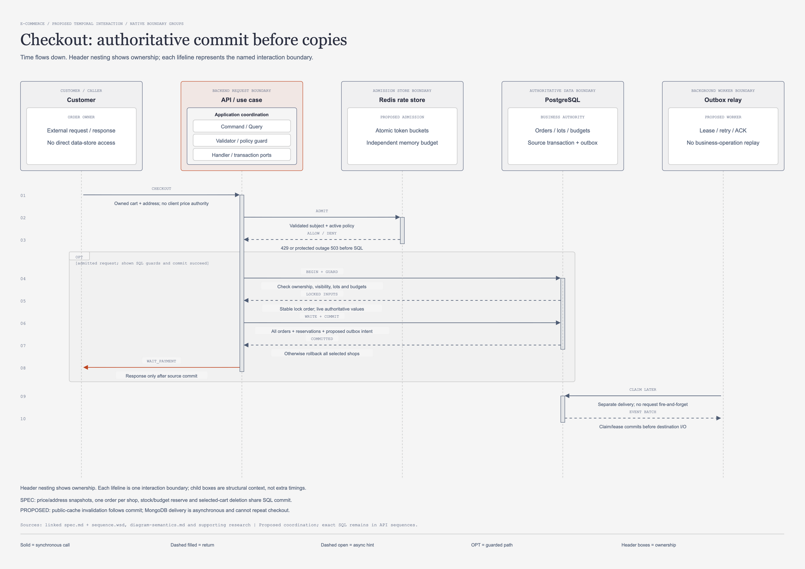

# Checkout: commit คำสั่งซื้อก่อนส่งสำเนา

[เปิดภาพแก้ไขได้](checkout-sequence.drawio.png) · [draw.io source](checkout-sequence.drawio) · [HTML preview](checkout-sequence.html)

## จุดประสงค์และขอบเขต

ภาพนี้ตอบว่าคำสั่งสร้าง order จอง stock และงบส่วนลดพร้อมกันอย่างไร และเหตุใดการส่งสำเนาจึงเริ่มหลัง source commit
ตรวจทานวันที่ 2026-11-07 เป็น design artifact สถานะ in-review; ไม่ใช่ผลทดสอบ backend หรือหลักฐานว่า worker ทำงานแล้ว
คำว่า CHECKOUT ในภาพหมายถึงการยืนยันสร้าง order ของรายการที่เลือก ไม่ใช่ GET preview และไม่เรียก Stripe ในภาพนี้
Preview อ่านราคาและ budget ปัจจุบันโดยไม่จอง; การยืนยันต้องอ่านและตรวจใหม่เพราะข้อมูลเปลี่ยนได้ระหว่างสองคำขอ
หนึ่งคำขอสร้างหนึ่ง order ต่อ shop แต่ทุก shop อยู่ใน transaction เดียว ไม่มีผลสำเร็จบาง shop
[Preview SPEC](../doc/api/sales/01-inquiry-checkout/spec.md) และ [Create order SPEC](../doc/api/sales/02-create-order/spec.md) กำกับพฤติกรรมนี้

สถานะ SPEC หมายถึงสิ่งที่เอกสารปัจจุบันระบุ; ไม่ยืนยัน approval ของ legacy spec ที่ยังไม่มี approval frontmatter ครบ
PROPOSED ในภาพครอบคลุม Redis admission, publication intent และ relay; ยังไม่มีการเพิ่มตารางหรือ endpoint

## ผู้ร่วมงานและขอบเขตหน้าที่

| ID | ป้าย lifeline ตามภาพ | บทบาทตาม model |
| --- | --- | --- |
| `customer` | Customer | ORDER OWNER |
| `api` | API / use case | SPEC + PROPOSED PORTS |
| `redis` | Redis rate store | PROPOSED ADMISSION |
| `sql` | PostgreSQL | BUSINESS AUTHORITY |
| `relay` | Outbox relay | PROPOSED WORKER |

## ลำดับข้อความตามภาพ

ตารางคงชื่อข้อความ รายละเอียด และลำดับจาก `supporting_content.py` โดยตรง; คอลัมน์ทางเดินบอกว่าแถวใดเลือกทำแทนกัน

| ลำดับ | จาก → ถึง | Message | Detail ตาม model | ทางเดิน |
| --- | --- | --- | --- | --- |
| 1 | `customer → api` | CHECKOUT | Owned cart + address; no client price authority | ร่วม |
| 2 | `api → redis` | ADMIT | Validated subject + active policy | ร่วม |
| 3 | `redis → api` | ALLOW / DENY | 429 or protected outage 503 before SQL | ร่วม |
| 4 | `api → sql` | BEGIN + GUARD | Check ownership, visibility, lots and budgets | เมื่อ ALLOW |
| 5 | `sql → api` | LOCKED INPUTS | Stable lock order; live authoritative values | เมื่อ ALLOW |
| 6 | `api → sql` | WRITE + COMMIT | All orders + reservations + proposed outbox intent | เมื่อ ALLOW |
| 7 | `sql → api` | COMMITTED | Otherwise rollback all selected shops | เมื่อ ALLOW |
| 8 | `api → customer` | WAIT_PAYMENT | Response only after source commit | เมื่อ ALLOW |
| 9 | `relay → sql` | CLAIM LATER | Separate delivery; no request fire-and-forget | ภายหลัง commit |
| 10 | `sql → relay` | EVENT BATCH | Claim/lease commits before destination I/O | ภายหลัง commit |

## อ่านทางเดินให้ถูกต้อง

ข้อความ 1–3 เป็นการรับคำขอและขอ admission ตาม policy ที่เสนอ
ALLOW ทำให้ข้อความ 4–8 เดินต่อ; DENY หรือ protected-store unavailable จบก่อนเริ่ม SQL จึงไม่มี reservation ให้คืน
ข้อความ ALLOW / DENY เป็นคำตอบเดียวที่เลือกผลได้ ไม่ใช่ให้สิทธิ์แล้วปฏิเสธในคำขอเดียว
ตัวเลข 429/503 ใน model มาจาก Redis proposal; body และ bizCode สำหรับ policy ใหม่ยังต้องผ่าน API review
ข้อความ 9–10 เกิดภายหลัง source commit โดย relay เป็นผู้ claim งาน ไม่ใช่ request เปิด background task แล้วหวังว่าจะส่งสำเร็จ
ภาพนี้จบที่ EVENT BATCH; การส่ง MongoDB และ acknowledgement แยกไป [outbox sequence](outbox-delivery-sequence.md)

## Transaction และอำนาจของข้อมูล

PostgreSQL ตรวจเจ้าของ cart/address, ACTIVE visibility, lot ที่ขายอยู่, quantity และ campaign budget จากข้อมูลจริง
ราคา ที่อยู่ และ lot reference ถูก snapshot ลง order/item; client ไม่มีสิทธิ์กำหนดราคา รวมถึงผล preview ไม่ใช่ราคา guarantee
การเขียน order/items, หัก stock, หัก budget, RESERVE ledger และลบ cart ที่เลือกต้อง commit หรือ rollback พร้อมกัน
ลำดับ lock ของ lot และ budget ต้องคงที่ตาม canonical SPEC; ภาพสรุปไม่เพิ่ม global Redis lock เพื่อแทนข้อกำหนดนี้
Conditional update ต้องตรวจจำนวนแถวที่เปลี่ยน; การตรวจผ่านก่อนหน้าอย่างเดียวกัน concurrent checkout ไม่ได้
WAIT_PAYMENT ส่งกลับหลัง COMMITTED เท่านั้น ไม่หมายความว่าเงินเข้า และไม่เปลี่ยนเป็น PAYMENT_CONFIRMED ใน flow นี้
หาก outbox ได้รับอนุมัติ publication intent ต้อง commit ใน transaction เดียวกับ business writes; ไม่มี transaction ครอบ SQL กับ MongoDB
Relay claim ใช้ transaction สั้นและ commit lease ก่อน network I/O จึงไม่ถือ row lock ระหว่างรอ destination

## เหตุผลและทางเลือกที่ต้องแลก

All-or-nothing ต่อ cart selection ทำให้ลูกค้าไม่พบคำสั่งซื้อบางร้านสำเร็จโดยไม่ได้ตั้งใจ แต่ transaction มีโอกาสชนกันมากขึ้นเมื่อเลือกหลาย shop
การตรวจ live stock/budget เพิ่ม SQL work แต่รักษากติกาไม่ oversell และไม่จองงบเกินที่เหลือ
Redis admission ลดภาระก่อน mutation ตาม policy ที่เสนอ; มันไม่บอกว่า order ถูกสร้างแล้วและไม่เก็บ durable idempotency
การส่ง projection ภายหลังช่วยให้ MongoDB outage ไม่ทำให้ order ที่ commit แล้วล้มเหลว แต่สำเนามี lag ที่ต้องแสดงและติดตาม
การ invalidation cache หลัง commit ล้มเหลวไม่ย้อน order; ตาม [Redis design](redis-design.md) cache ไม่เก็บราคา/stock ที่ใช้ตัดสิน checkout
Checkout retry หลัง response สูญหายยังต้องออกแบบ command identity เพิ่มเติมก่อนอ้างว่าคำขอซ้ำจะไม่สร้าง order ใหม่
หากเพิ่ม caller key ต้องผูกกับ authenticated owner และพารามิเตอร์ที่ canonicalize แล้ว; key เดียวแต่คนละ cart/address ต้องไม่กลายเป็นคำสั่งใหม่

## Failure และช่องว่างระหว่าง SPEC กับข้อเสนอ

- Stock หรือ budget ถูกซื้อไปก่อน: conditional write ไม่สำเร็จและ rollback ทุก shop; ไม่เงียบเปลี่ยนส่วนลดเป็นราคาสูงขึ้น
- SQL commit ไม่สำเร็จ: ไม่ส่ง WAIT_PAYMENT และไม่สร้างงาน relay จากข้อมูลที่ยังไม่ commit
- Commit สำเร็จแต่ response หาย: ข้อมูลยังอยู่; ต้องค้นคืนผลคำสั่งเดิมตาม future contract ไม่เดาว่า rollback แล้ว
- Relay ล่มก่อน claim: durable publication intent รอ claim ได้หลังเริ่มใหม่ หาก outbox schema ได้รับอนุมัติ
- Relay ล่มหลัง claim: lease/replay protocol ต้องทำให้งานกลับมาได้โดยไม่สร้าง order หรือหัก stock รอบใหม่
- MongoDB ล่ม: ไม่รัน checkout ซ้ำเพื่อสร้าง audit ที่ขาด และไม่เปลี่ยน PostgreSQL authority

SPEC ปัจจุบันยังไม่ได้กำหนด outbox table, payload version, lease หรือ caller command contract
ภาพจึงเสนอจุดวาง publication intent เท่านั้น ไม่อนุญาตให้เพิ่ม SQL field หรือเปลี่ยน API response โดยอาศัยภาพนี้
[MongoDB design](mongodb-design.md) กำหนดสำเนาเป็น derived store; เรื่อง retention และ replay ต้องตรวจพร้อม outbox design
Exact SQL, transaction exits และ table activations อ่านคู่ [spec.md](../doc/api/sales/02-create-order/spec.md) กับ [sequence.wsd](../doc/api/sales/02-create-order/sequence.wsd)

## เกณฑ์ตรวจรับก่อนพัฒนา

- [ ] Message/actor ในภาพและตารางตรง model ทุกชื่อและลำดับ; DENY ไม่เดินเข้า SQL
- [ ] สอง checkout แย่ง lot สุดท้ายได้ผู้ชนะตามจำนวนจริง อีกคำขอ rollback ทุก shop
- [ ] Budget ของ campaign ไม่พอต้อง rollback stock/order/cart ทั้งชุด
- [ ] ราคาหรือ visibility เปลี่ยนหลัง preview แล้ว create-order ตรวจใหม่
- [ ] WAIT_PAYMENT ส่งได้เมื่อ transaction commit ยืนยันแล้วเท่านั้น
- [ ] Proposed outbox intent หายไปพร้อม business rollback และคงอยู่พร้อม business commit
- [ ] Relay retry ไม่สร้าง order หรือ RESERVE ซ้ำ และไม่ถือ SQL lock ระหว่าง network call
- [ ] Owner/key/parameter binding และผล replay ของ command ได้ข้อสรุปใน canonical contract ก่อน implement

Checklist เป็นข้อพิสูจน์ที่ต้องทำในงานถัดไป ไม่ใช่รายการทดสอบที่รันผ่านแล้วในงานภาพ

## หลักฐานและเอกสารต่อเนื่อง

[แผนชุดภาพ](implementation-readiness-plan.md) ระบุวัตถุประสงค์ coordination view; [payment research](supporting-payments-research.md) ระบุขอบเขตการชำระเงินที่ตามมา
[PostgreSQL row locks](https://www.postgresql.org/docs/current/explicit-locking.html#LOCKING-ROWS) อธิบาย lock ที่อยู่ถึงจบ transaction; lock นี้ไม่รวม remote provider
[MongoDB transactions](https://www.mongodb.com/docs/manual/core/transactions/) ครอบคลุม MongoDB operations; ข้อเสนอ outbox จึงไม่อ้าง shared SQL/MongoDB commit

## โครงสร้างภาพหลังการทบทวนความหมาย

ภาพนี้เป็น **Sequence ของสถานการณ์หนึ่ง**: แกนตั้งคือเวลา ลูกศรคือข้อความระหว่าง interaction boundaries และ activation bar แสดงช่วงที่กำลังประมวลผล ไม่ใช่ compile dependency หรือสถานะที่บันทึกใน order

Header แสดง ownership เป็นกล่องซ้อนที่มี parent/child จริงใน draw.io: caller/provider อยู่ในขอบเขตภายนอก, PostgreSQL/MongoDB/Redis อยู่ในขอบเขตข้อมูลของตน และ backend request boundary แสดง Application coordination ที่แยก `Command / Query`, `Validator / policy guard`, `Handler / transaction ports` เป็นกล่องย่อย ผู้เรียกผ่าน API/transport ตาม contract; lifeline ฝั่ง backend เป็นตัวแทน use-case boundary รวม ไม่ได้อ้างว่ากล่องย่อยทั้งสามมีเวลาแยกกันหรือเป็นสาม services การดูรายละเอียดการเรียกภายใน/ตำแหน่ง Dispatcher ให้ใช้ [Architecture](architecture-design.md) และ [Repository](repository-architecture.md)

กรอบ `ALT` และข้อความภายในเป็นกลุ่ม native แยกจาก header ownership: สองแขนงคือทางเลือกที่ขึ้นกับ guard ไม่ใช่ขั้นตอนที่ต้องทำต่อกันทุกครั้ง Return ใช้เส้นประหัวทึบ; async refresh hint ใช้หัวโปร่ง; SQL/provider ไม่ได้เป็น participant ใน transaction เดียวข้ามระบบ อ่านขอบเขตและข้อจำกัดของ notation จาก [ความหมายทั้งชุด](diagram-semantics.md)

### Admission gate ในภาพฉบับตรวจรับ

กรอบ `OPT` ครอบขั้นตอนSQLและsuccess responseเฉพาะ admitted requestและกรณีที่guards/commitสำเร็จ เมื่อadmissionปฏิเสธ429หรือprotected store outage503 จะไม่เดินเข้าSQL pathนี้ และguard/transaction failureต้องrollbackตามcanonical spec การclaimภายหลังอ่านได้เฉพาะpublicationที่sourcecommitจริง ไม่ถือว่าALLOW/DENYแล้วทุกrequestต้องสร้างorderต่อ
