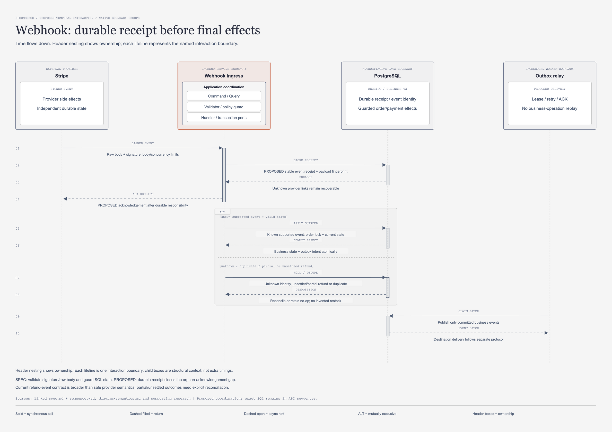

# Stripe webhook: รับผิดชอบ event ก่อนประมวลผลสุดท้าย

[เปิดภาพแก้ไขได้](payment-webhook-sequence.drawio.png) · [draw.io source](payment-webhook-sequence.drawio) · [HTML preview](payment-webhook-sequence.html)

## จุดประสงค์และขอบเขต

ภาพนี้ตอบว่าจะไม่ทำ event สูญหายเมื่อ provider payment ยังจับคู่ SQL ไม่ได้ และไม่ทำ stock/budget ซ้ำเมื่อ event ถูกส่งซ้ำอย่างไร
ตรวจทานวันที่ 2026-11-07 เป็น coordination proposal สถานะ in-review; ยังไม่มี inbox, consumer หรือ outbox ที่งานนี้ implement
SPEC ปัจจุบันประมวลผล event ในหนึ่ง transaction แล้วตอบผล; unknown providerPaymentId กลับ 200 IGNORED
ภาพเสนอ durable receipt ก่อน ACK เพื่อรับผิดชอบการกู้ต่อ แม้ business mutation ยังไม่พร้อม
การเปลี่ยนจุด ACK นี้เปลี่ยน contract การประมวลผลจริง ต้องอนุมัติ canonical API/schema และ operational ownership ก่อน
[Webhook SPEC](../doc/api/payment/02-stripe-webhook/spec.md) เป็น baseline; สิ่งที่เขียนว่า SPEC ไม่ใช่คำยืนยัน implementation หรือ approval metadata ที่ขาดอยู่

ภาพไม่แสดง Redis/MongoDB ในทางรับ event เพราะ signed provider callbacks ต้องไม่ขึ้นกับ cache/admission หรือ derived copies
ACK RECEIPT บอกว่าเก็บ event อย่าง durable แล้ว ไม่บอกว่าจ่ายเงินสำเร็จหรือคืนเงินสำเร็จ

## ผู้ร่วมงานและขอบเขตหน้าที่

| ID | ป้าย lifeline ตามภาพ | บทบาทตาม model |
| --- | --- | --- |
| `stripe` | Stripe | SIGNED EVENT |
| `api` | Webhook ingress | SPEC + PROPOSED RECEIPT |
| `sql` | PostgreSQL | RECEIPT / BUSINESS TX |
| `relay` | Outbox relay | PROPOSED DELIVERY |

## ลำดับข้อความตามภาพ

ตารางคงชื่อข้อความ รายละเอียด และลำดับจาก `supporting_content.py` โดยตรง; คอลัมน์ทางเดินบอกว่าแถวใดเลือกทำแทนกัน

| ลำดับ | จาก → ถึง | Message | Detail ตาม model | ทางเดิน |
| --- | --- | --- | --- | --- |
| 1 | `stripe → api` | SIGNED EVENT | Raw body + signature; body/concurrency limits | ร่วม |
| 2 | `api → sql` | STORE RECEIPT | PROPOSED stable event receipt + payload fingerprint | ร่วม |
| 3 | `sql → api` | DURABLE | Unknown provider links remain recoverable | ร่วม |
| 4 | `api → stripe` | ACK RECEIPT | PROPOSED acknowledgement after durable responsibility | ร่วม |
| 5 | `api → sql` | APPLY GUARDED | Known supported event; order lock + current state | ALT A |
| 6 | `sql → api` | COMMIT EFFECT | Business state + outbox intent atomically | ALT A |
| 7 | `api → sql` | HOLD / DEDUPE | Unknown identity, unsettled/partial refund or duplicate | ALT B |
| 8 | `sql → api` | DISPOSITION | Reconcile or retain no-op; no invented restock | ALT B |
| 9 | `relay → sql` | CLAIM LATER | Publish only committed business events | ต่อเฉพาะ event ที่ commit |
| 10 | `sql → relay` | EVENT BATCH | Destination delivery follows separate protocol | ต่อเฉพาะ event ที่ commit |

## อ่านลำดับและ ALT

ข้อความ 1 ต้องตรวจ signature กับ raw body, endpoint secret และ timestamp tolerance ก่อนข้อความ 2 เสมอ; note นี้ไม่ใช่ SQL message เพิ่ม
ข้อความ 2–4 เป็นทางเดินร่วมของ verified event เมื่อ durable receipt commit สำเร็จ; receipt failure ต้องไม่ส่ง ACK สำเร็จ
ALT A คือข้อความ 5–6 เมื่อ `known supported event + valid state` เท่านั้น
ALT B คือข้อความ 7–8 เมื่อ `unknown / duplicate / partial or unsettled refund`; ไม่รันต่อจาก COMMIT EFFECT ของ ALT A
SAFE DISPOSITION สำหรับ duplicate ที่พิสูจน์แล้วคือ no-op; unknown/partial/unsettled ต้องเก็บเหตุผลและเส้นทาง reconciliation
ข้อความ 9–10 มีได้เฉพาะ committed business event ที่มี publication intent; receipt อย่างเดียวไม่ก่อ event อ้างว่ามี financial effect
API lifeline รวม ingress กับ use-case responsibility แบบย่อ ไม่ได้เลือกว่าจะใช้ HTTP thread หรือ process เดียวเป็น consumer
Future consumer hosting/claim/lease ต้องออกแบบให้กู้ต่อหลัง ACK ได้ มิฉะนั้น durable receipt เพียงอย่างเดียวยังปิดงานไม่ได้

## Transaction, authority และ guard

Receipt transaction เก็บ stable event ID, fingerprint และข้อมูลขั้นต่ำที่ตรวจสอบ/กู้ต่อได้; schema/retention ยังเป็นข้อเสนอ
Duplicate ID กับ fingerprint เดิมไม่ให้ business effect รอบสอง; ID เดิมแต่ payload ต่างต้องเก็บ conflict เพื่อตรวจสอบ
Business transaction ต้องรวม current-state guards, mutation และ completion evidence ของ receipt เพื่อกันสอง consumer apply ซ้ำ
หาก outbox อนุมัติ ต้องเขียน publication intent ใน transaction เดียวกับ business effect ไม่ใช้ missing MongoDB audit เป็นเหตุ apply ใหม่
Lock order เริ่มที่ order เช่น start/refund/shipping; หลัง lock ต้องอ่าน state ที่ใช้ตัดสินอีกครั้ง ไม่ใช้ snapshot ก่อนรอ lock
จับคู่ providerPaymentId กับ operation/payment/order และตรวจ amount, currency, account/mode และชนิด object ก่อนยืนยันผล
Metadata เป็น correlation hint ไม่ใช่สิทธิ์สร้าง payment หรือยืนยันยอดโดยข้าม trusted local association
payment_intent.succeeded ไม่เปิด order ที่ CANCELLED กลับมาขาย; late-payment compensation ต้องใช้ policy และ stable refund identity
PostgreSQL ยังคง authoritative สำหรับ order/payment/stock/budget; signature ยืนยันต้นทางแต่ไม่ได้แปลว่า event ทุกชนิดควรเปลี่ยน state

## เหตุผลและข้อแลกเปลี่ยน

Durable receipt ปิดช่องที่ payment link หายหลัง provider success แล้ว webhook ถูก ACK ทิ้งโดยไม่มี local row
การ ACK เร็วกว่าการจบ business effect ลด timeout แต่ระบบต้องรับภาระ retry, poison handling และ operator visibility ของตนเอง
Stripe อาจส่งซ้ำหรือผิดลำดับ จึงไม่ใช้ event.created เป็นลำดับเด็ดขาดหรือเป็น duplicate key
Event ID ช่วย dedupe delivery; แยก event คนละ ID ที่มี object/type เดียวกันยังต้องมี state guards ไม่ใช้ hash อย่างเดียว
[Stripe webhooks](https://docs.stripe.com/webhooks) ระบุ raw-body verification, duplicate delivery และ retry; live retry มีขอบเขตไม่ใช่คิวถาวร
เก็บ raw provider payload ถาวรไม่ใช่ข้อกำหนดจากภาพนี้; ต้องอนุมัติ minimization, encryption, access และ retention ก่อน
ไม่มี shared transaction ระหว่าง receipt SQL, Stripe และ MongoDB และไม่อ้าง exactly-once event delivery

## Failure cases และช่องว่าง SPEC

- Signature ผิดหรือ payload ถูกแปลงก่อนตรวจ: ไม่ persist receipt/business effect ตามเส้นทาง trusted event
- Receipt commit ล้มเหลว: ไม่ ACK สำเร็จ; provider retry ต้องยังสามารถเข้าใหม่ได้
- ACK response หายหลัง receipt commit: retry พบ receipt เดิมและไม่สร้าง business effect ซ้ำ
- Consumer ล่มหลัง ACK: receipt ที่ยังไม่ apply ต้องค้นและ claim ใหม่ได้ตาม future worker design
- Unknown provider identity: เก็บหลักฐานเพื่อกู้ association ไม่กลับ 200 แล้วลืมตาม baseline เดิม
- Event ย้อนลำดับ: current-state guard ป้องกัน final state ถอยหลัง แต่ต้องตรวจ provider current state เมื่อข้อมูลขัดแย้ง

charge.refunded รวม partial refunds; Refund object ยังอาจ pending/requires_action/failed/canceled จึงห้ามสรุป full REFUNDED จาก event name อย่างเดียว
[Stripe refund events](https://docs.stripe.com/refunds#refund-events) และ [Refund status](https://docs.stripe.com/api/refunds/object) เป็นหลักฐานของข้อจำกัดนี้
SPEC ปัจจุบันยังไม่แยกเงื่อนไขดังกล่าวและมี final payment statuses จำกัด; HOLD/DEDUPE ไม่ใช่ status หรือ bizCode ใหม่
Failure ของ MongoDB publication ไม่ย้อน SQL mutation และไม่เรียก charge/refund ซ้ำเพื่อสร้างเอกสาร log

## เกณฑ์ตรวจรับก่อนพัฒนา

- [ ] Actor/messages/ALT ตรง model; COMMIT EFFECT และ HOLD / DEDUPE เป็นทางเลือก
- [ ] Signature, raw body และ delivery timestamp ผ่านก่อน durable receipt
- [ ] Receipt save fail ไม่ ACK สำเร็จ; ACK loss ทำให้ replay ปลอดภัย
- [ ] Unknown association กู้ได้หลัง payment link กลับมา ไม่ถูกทิ้งถาวร
- [ ] Duplicate และสอง consumer แข่งกันไม่ทำ stock/campaign RELEASE ซ้ำ
- [ ] Current provider/local amount, currency, account/mode และ state ตรวจครบก่อน financial effect
- [ ] Partial/pending/failed refund ไม่ทำ full REFUNDED หรือ restock อัตโนมัติ
- [ ] Consumer restart, receipt retention และ reconciliation scan/index มี approved design ก่อน implement

Checklist เป็นงานตรวจรับในอนาคต ไม่มี runtime หรือ provider replay test ถูกอ้างว่าผ่านในเอกสารนี้

## หลักฐานและเอกสารต่อเนื่อง

อ่าน [canonical spec.md](../doc/api/payment/02-stripe-webhook/spec.md) คู่ [sequence.wsd](../doc/api/payment/02-stripe-webhook/sequence.wsd) สำหรับ exact SQL และ transaction/table activations
[Payment research](supporting-payments-research.md), [MongoDB proposal](mongodb-design.md) และ [outbox sequence](outbox-delivery-sequence.md) อธิบายจุดแยก receipt, business effect และ projection delivery
[Stripe error recovery](https://docs.stripe.com/error-low-level) อธิบาย provider object ที่อาจมีผลสำเร็จแม้ local integration ยังไม่ได้รับ API response

## โครงสร้างภาพหลังการทบทวนความหมาย

ภาพนี้เป็น **Sequence ของสถานการณ์หนึ่ง**: แกนตั้งคือเวลา ลูกศรคือข้อความระหว่าง interaction boundaries และ activation bar แสดงช่วงที่กำลังประมวลผล ไม่ใช่ compile dependency หรือสถานะที่บันทึกใน order

Header แสดง ownership เป็นกล่องซ้อนที่มี parent/child จริงใน draw.io: caller/provider อยู่ในขอบเขตภายนอก, PostgreSQL/MongoDB/Redis อยู่ในขอบเขตข้อมูลของตน และ backend request boundary แสดง Application coordination ที่แยก `Command / Query`, `Validator / policy guard`, `Handler / transaction ports` เป็นกล่องย่อย ผู้เรียกผ่าน API/transport ตาม contract; lifeline ฝั่ง backend เป็นตัวแทน use-case boundary รวม ไม่ได้อ้างว่ากล่องย่อยทั้งสามมีเวลาแยกกันหรือเป็นสาม services การดูรายละเอียดการเรียกภายใน/ตำแหน่ง Dispatcher ให้ใช้ [Architecture](architecture-design.md) และ [Repository](repository-architecture.md)

กรอบ `ALT` และข้อความภายในเป็นกลุ่ม native แยกจาก header ownership: สองแขนงคือทางเลือกที่ขึ้นกับ guard ไม่ใช่ขั้นตอนที่ต้องทำต่อกันทุกครั้ง Return ใช้เส้นประหัวทึบ; async refresh hint ใช้หัวโปร่ง; SQL/provider ไม่ได้เป็น participant ใน transaction เดียวข้ามระบบ อ่านขอบเขตและข้อจำกัดของ notation จาก [ความหมายทั้งชุด](diagram-semantics.md)

### ผู้รับผิดชอบหลังรับ ACK

Lifelineนี้เป็นlogical webhook service boundary รวมingressและproposed durable receipt processor เมื่อACKแล้วpending receiptยังต้องมีconsumer/reconciliationที่claimและdrainอย่างdurable ไม่ใช่รับประกันว่าin-memorycontinuationของHTTPrequestจะทำงานต่อจนครบ Hostingของconsumerและสัญญาclaimยังต้องผ่านการออกแบบ/อนุมัติก่อนimplementation ส่วนoutboxrelayในภาพทำหน้าที่ส่งcommitted business eventsภายหลัง ไม่ใช่consumerที่มาสร้างfinancialeffectซ้ำ
