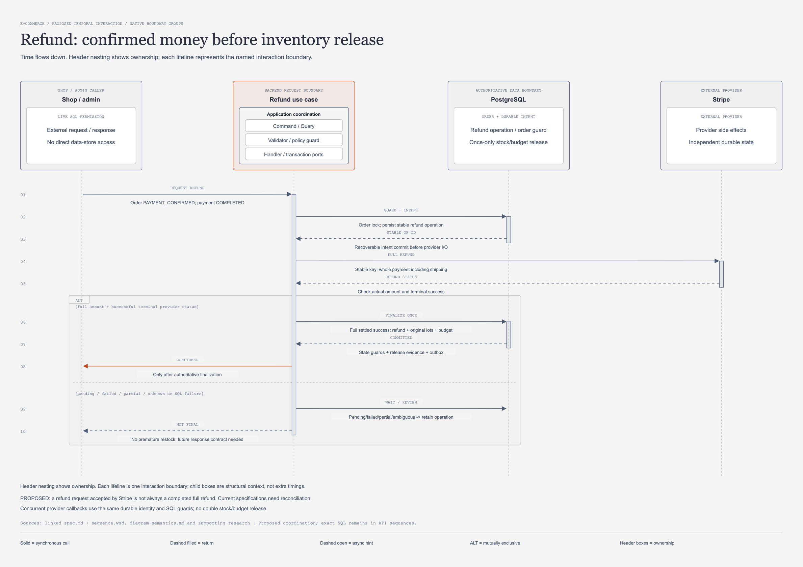

# คืนเงิน: ยืนยันผลทางการเงินก่อนปล่อย stock และงบ

[เปิดภาพแก้ไขได้](refund-sequence.drawio.png) · [draw.io source](refund-sequence.drawio) · [HTML preview](refund-sequence.html)

## จุดประสงค์และขอบเขต

ภาพนี้ตอบว่าเมื่อใดจึงเรียกคืนเงิน และผล provider แบบใดจึงอนุญาตให้เปลี่ยน order กับคืน stock/campaign budget
ตรวจทานวันที่ 2026-11-07 เป็น recovery design สถานะ in-review; ยังไม่สร้าง operation table หรือเปลี่ยน refund API จริง
เริ่มจาก shop ADMIN/STAFF ที่ ACTIVE หรือ PLATFORM_ADMIN ขอ full refund; customer ไม่มีสิทธิ์เรียก flow นี้โดยตรง
Baseline ต้องเป็น payment COMPLETED และ order PAYMENT_CONFIRMED; order ที่เริ่ม ship แล้วใช้ refund API นี้ไม่ได้
Refund รวม shipping fee; ไม่เสนอ partial refund product flow หรือ return process เพิ่มในภาพนี้
[SPEC ปัจจุบัน](../doc/api/payment/05-refund-payment/spec.md) เรียก provider แล้ว mark REFUNDED ใน local transaction เดียว ซึ่งไม่ครอบคลุม provider outcomes ทุกแบบ

SPEC คือพฤติกรรมที่เอกสารปัจจุบันระบุ ไม่ยืนยัน runtime หรือ approval metadata ของ legacy contract
Flow durable intent และการรอ actual final outcome ในภาพเป็น PROPOSED ที่ต้องปรับ canonical API/schema ผ่าน review ก่อน

## ผู้ร่วมงานและขอบเขตหน้าที่

| ID | ป้าย lifeline ตามภาพ | บทบาทตาม model |
| --- | --- | --- |
| `operator` | Shop / admin | LIVE SQL PERMISSION |
| `api` | Refund use case | PROPOSED RECOVERY |
| `sql` | PostgreSQL | ORDER + DURABLE INTENT |
| `stripe` | Stripe | EXTERNAL PROVIDER |

## ลำดับข้อความตามภาพ

ตารางคงชื่อข้อความ รายละเอียด และลำดับจาก `supporting_content.py` โดยตรง; คอลัมน์ทางเดินบอกว่าแถวใดเลือกทำแทนกัน

| ลำดับ | จาก → ถึง | Message | Detail ตาม model | ทางเดิน |
| --- | --- | --- | --- | --- |
| 1 | `operator → api` | REQUEST REFUND | Order PAYMENT_CONFIRMED; payment COMPLETED | ร่วม |
| 2 | `api → sql` | GUARD + INTENT | Order lock; persist stable refund operation | ร่วม |
| 3 | `sql → api` | STABLE OP ID | Recoverable intent commit before provider I/O | ร่วม |
| 4 | `api → stripe` | FULL REFUND | Stable key; whole payment including shipping | ร่วม |
| 5 | `stripe → api` | REFUND STATUS | Check actual amount and terminal success | ร่วม |
| 6 | `api → sql` | FINALIZE ONCE | Full settled success: refund + original lots + budget | ALT A |
| 7 | `sql → api` | COMMITTED | State guards + release evidence + outbox | ALT A |
| 8 | `api → operator` | CONFIRMED | Only after authoritative finalization | ALT A |
| 9 | `api → sql` | WAIT / REVIEW | Pending/failed/partial/ambiguous -> retain operation | ALT B |
| 10 | `api → operator` | NOT FINAL | No premature restock; future response contract needed | ALT B |

## ทางเดินร่วมและ ALT

ข้อความ 1–5 ใช้ร่วมกัน: รับคำขอ ตรวจสิทธิ์และ state เก็บ recoverable operation แล้วรับ actual refund status
ALT A คือข้อความ 6–8 เมื่อ `full amount + successful terminal provider status` และ SQL finalization สำเร็จ
FINALIZE ONCE ไม่ได้เกิดเพียงเพราะ Stripe รับคำขอ; ต้องตรวจ refund object/status, amount และ association ให้ครบ
CONFIRMED ส่งหลัง COMMITTED เท่านั้น; message label นี้ยังไม่กำหนด HTTP/bizCode ใหม่
ALT B คือข้อความ 9–10 เมื่อ `pending / failed / partial / unknown or SQL failure`; ไม่รันต่อจาก CONFIRMED ของ ALT A
หาก provider คืน succeeded แต่ SQL commit ล้มเหลว ก็เลือก ALT B เพื่อ reconcile local finalization ไม่สั่ง refund ใหม่
WAIT / REVIEW เก็บ operation/evidence ให้กู้ต่อ ไม่เปลี่ยน order/payment เป็น status ใหม่โดยอัตโนมัติ
ภาพนี้ไม่ได้รวมทุก callback arrow; webhook ต้องใช้ durable identity และ guard ชุดเดียวกันเมื่อมาถึงก่อนหรือหลัง HTTP request

## Transaction และอำนาจของข้อมูล

GUARD + INTENT ใช้ live SQL permission, order lock และ payment/order association ไม่อ่านสิทธิ์จาก MongoDB projection
Operation record ต้อง commit ก่อน provider I/O และผูกกับ payment, order, full amount/currency และ immutable parameters
Caller key ต้อง owner/principal-scoped พร้อมสิทธิ์ที่ตรวจใหม่ และ parameter-bound; user อื่นใช้ key ซ้ำแล้วอ่าน refund ของเจ้าของไม่ได้
Provider key ของ logical refund เดียวต้องคงเดิมข้าม retry/restart; ข้อกำหนด mapping กับ key `refund-<paymentId>` เดิมต้องออกแบบให้เข้ากัน
ไม่ถือ SQL lock ข้าม network call; intent guard ต้องกัน shipping หรือ refund operation ที่ขัดแย้งระหว่างช่วงรอผล
FINALIZE ONCE ต้อง lock order และตรวจ current state อีกครั้ง รวมถึงผล webhook ที่อาจ commit ไปแล้ว
เมื่อ policy ที่อนุมัติยืนยัน full success จึงแก้ payment/order, เพิ่ม quantity กลับ original lot และ RELEASE campaign budget ใน transaction เดียว
Lock order ยังคง order → lots ตาม id → budgets ตาม id; lot เก่าที่ไม่ขายแล้วก็เป็น stock history เดิมตาม SPEC
Release evidence ต้องกัน double release แม้ request, webhook และ reconciler แข่งกัน; response loss ไม่ใช่เหตุเพิ่ม quantity รอบใหม่
Outbox intent ถ้าอนุมัติต้องอยู่ใน finalization transaction; MongoDB copy ไม่เป็นผู้ตัดสินว่าคืนเงินจริงแล้ว

## เหตุผลและ trade-offs

Stripe Refund มีสถานะ pending/requires_action/succeeded/failed/canceled; การคืน refund ID จึงไม่พอจะสรุป full final success
[Refund object](https://docs.stripe.com/api/refunds/object) ระบุ status และ next_action; PromptPay อาจต้องใช้ customer instructions ที่ SPEC ปัจจุบันยังไม่ครอบคลุม
charge.refunded ยังเกิดสำหรับ partial refund ที่ทำจาก Dashboard; webhook name อย่างเดียวจึงไม่พิสูจน์ว่าคืนยอดรวมแล้ว
[Refund events](https://docs.stripe.com/refunds#refund-events) ระบุข้อเท็จจริงนี้ และเป็นเหตุให้ ALT B ต้องรองรับ partial/unsettled outcomes
การรอผลยืนยันก่อนคืน stock ลดความเสี่ยงขายสินค้ารอบใหม่ทั้งที่ผลทางการเงินยังไม่จบ แต่ทำให้ operations ต้องติดตามรายการค้าง
นโยบายว่าจะพัก fulfilment และจัดการ failed refund อย่างไรเป็น product/operational decision ที่ยังต้องอนุมัติ ไม่ได้สรุปจากชื่อ WAIT / REVIEW
Refund accepted, bank processing และ customer เห็นยอดคืนเป็นคนละ milestone; ภาพไม่รับรองเวลาที่เงินจะปรากฏในบัญชีลูกค้า

## Failure และ reconciliation

- Permission ไม่ผ่านหรือ state เปลี่ยนเป็น PROCESSING จาก shipping: ไม่เรียก provider ตาม refund path นี้
- Intent commit fail: ไม่ส่ง FULL REFUND เพราะไม่มี durable operation ให้กู้ต่อ
- Provider timeout/500: อาจมี refund อยู่แล้ว ต้อง retrieve/reconcile ด้วย identity เดิม ไม่สร้าง operation ใหม่จากการกดซ้ำ
- Provider full success แต่ SQL fail: รักษาหลักฐานและ finalize เดิมอีกครั้งภายใต้ guard; ไม่คืนเงินหรือ stock ซ้ำ
- Pending/requires_action: เก็บ action/owner ที่ต้องติดตามตาม future contract และห้าม mark full REFUNDED ล่วงหน้า
- Partial หรือ failed outcome: retain evidence และ operator review; ไม่มี automatic full restock ตามสมมติฐานเดิม

Stripe API v1 key มี retention จำกัด; unresolved POST retry ใช้ key/parameters เดิมใน 24 ชั่วโมงแรก แล้วหยุด POST เพื่อ reconcile หากยังไม่ทราบผล
[Stripe error handling](https://docs.stripe.com/error-low-level#post-requests) และ [idempotency](https://docs.stripe.com/api/idempotent_requests) ไม่ให้ permanent deduplication แทน application record
Late payment หลัง order CANCELLED ต้องคืนเงินตาม compensation policy แต่ stock/budget เคยกลับแล้ว จึงไม่ปล่อยซ้ำ
[Webhook SPEC](../doc/api/payment/02-stripe-webhook/spec.md) และ [cancel SPEC](../doc/api/sales/05-cancel-order/spec.md) ต้องถูก review คู่กันก่อนเปลี่ยน late-payment behavior
Current schema มี REFUNDED กับ required refund details แต่ไม่มี operation/pending-refund model; ต้องกำหนด lifecycle, reconciliation index และ authority แยก

## เกณฑ์ตรวจรับก่อนพัฒนา

- [ ] Model messages และ ALT ตรงภาพ; NOT FINAL ไม่ใช่ขั้นถัดจาก CONFIRMED
- [ ] Live permission และ payment/order guards ผ่านก่อนเก็บ intent/เรียก provider
- [ ] Caller key ผูก principal และ parameters; กดซ้ำหรือ restart ใช้ logical refund เดิม
- [ ] Full amount/currency/refund association และ successful terminal outcome ผ่านก่อน finalization
- [ ] Pending/partial/failed/refund instructions ไม่ทำ full REFUNDED หรือ stock/budget release ก่อน policy อนุมัติ
- [ ] Provider success + SQL failure reconcile จบได้โดยไม่ส่งเงินคืนอีกรอบ
- [ ] Request/webhook/reconciler พร้อมกันได้ RELEASE และ stock increment ชุดเดียว
- [ ] Late-payment compensation ไม่คืน stock/budget ที่ cancellation คืนไปแล้ว

Checklist เป็นเกณฑ์งาน implementation ภายหลัง ยังไม่มี runtime/provider settlement tests ถูกรันในงานภาพนี้

## หลักฐานและเอกสารต่อเนื่อง

อ่าน [refund spec.md](../doc/api/payment/05-refund-payment/spec.md) คู่ [sequence.wsd](../doc/api/payment/05-refund-payment/sequence.wsd) สำหรับ exact SQL, table activations และ HTTP/bizCodes เดิม
[Payment schema](../doc/schema/payment/t_payment.md), [payment research](supporting-payments-research.md) และ [แผนชุดภาพ](implementation-readiness-plan.md) ระบุช่องว่างที่ต้องปิดก่อน backend delivery
[MongoDB design](mongodb-design.md) ยืนยันว่า audit/projection ที่ตามหลังไม่มีอำนาจตัดสินเงินหรือ stock แทน PostgreSQL/provider reconciliation

## โครงสร้างภาพหลังการทบทวนความหมาย

ภาพนี้เป็น **Sequence ของสถานการณ์หนึ่ง**: แกนตั้งคือเวลา ลูกศรคือข้อความระหว่าง interaction boundaries และ activation bar แสดงช่วงที่กำลังประมวลผล ไม่ใช่ compile dependency หรือสถานะที่บันทึกใน order

Header แสดง ownership เป็นกล่องซ้อนที่มี parent/child จริงใน draw.io: caller/provider อยู่ในขอบเขตภายนอก, PostgreSQL/MongoDB/Redis อยู่ในขอบเขตข้อมูลของตน และ backend request boundary แสดง Application coordination ที่แยก `Command / Query`, `Validator / policy guard`, `Handler / transaction ports` เป็นกล่องย่อย ผู้เรียกผ่าน API/transport ตาม contract; lifeline ฝั่ง backend เป็นตัวแทน use-case boundary รวม ไม่ได้อ้างว่ากล่องย่อยทั้งสามมีเวลาแยกกันหรือเป็นสาม services การดูรายละเอียดการเรียกภายใน/ตำแหน่ง Dispatcher ให้ใช้ [Architecture](architecture-design.md) และ [Repository](repository-architecture.md)

กรอบ `ALT` และข้อความภายในเป็นกลุ่ม native แยกจาก header ownership: สองแขนงคือทางเลือกที่ขึ้นกับ guard ไม่ใช่ขั้นตอนที่ต้องทำต่อกันทุกครั้ง Return ใช้เส้นประหัวทึบ; async refresh hint ใช้หัวโปร่ง; SQL/provider ไม่ได้เป็น participant ใน transaction เดียวข้ามระบบ อ่านขอบเขตและข้อจำกัดของ notation จาก [ความหมายทั้งชุด](diagram-semantics.md)
