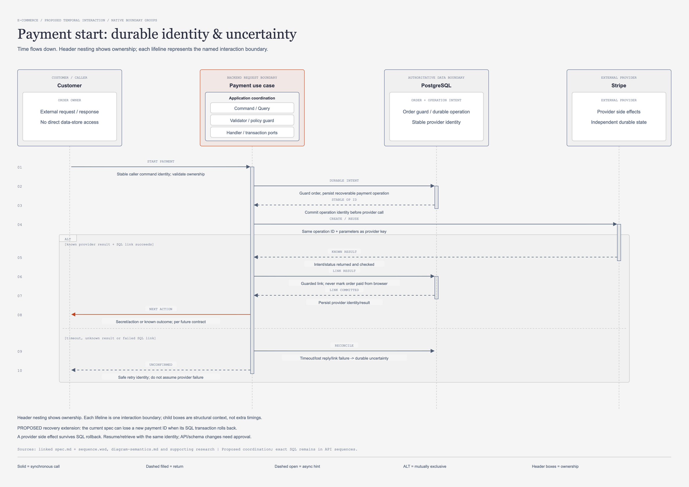

# เริ่มชำระเงิน: เก็บตัวตนคำสั่งก่อนเรียก provider

[เปิดภาพแก้ไขได้](start-payment-sequence.drawio.png) · [draw.io source](start-payment-sequence.drawio) · [HTML preview](start-payment-sequence.html)

## จุดประสงค์และขอบเขต

ภาพนี้ตอบว่าระบบจะจำ payment operation เดิมได้อย่างไรหาก Stripe ทำงานสำเร็จแต่ response หรือ SQL link สูญหาย
ตรวจทานวันที่ 2026-11-07 เป็นข้อเสนอ recovery สถานะ in-review; ยังไม่เพิ่ม operation table, worker หรือ HTTP response ใหม่
เริ่มเมื่อมี order WAIT_PAYMENT แล้ว ไม่ทำ checkout reservation ซ้ำ และไม่ยอมรับ amount ที่ browser กำหนด
ภาพไม่แสดง Stripe.js confirmation เพราะผล browser ไม่ใช่เหตุให้เปลี่ยน order เป็น paid
SPEC ปัจจุบันสร้าง PaymentIntent และ payment row ใน local transaction เดียว; รูปนี้เสนอแยก durable identity commit ก่อน external I/O
[Start payment SPEC](../doc/api/payment/01-start-payment/spec.md) เป็น baseline; flow recovery ในภาพยังต้องแก้และอนุมัติ canonical spec ก่อน implement

SPEC หมายถึงข้อกำหนดที่เขียนอยู่ ไม่ใช่หลักฐานว่า backend ทำครบหรือ legacy spec มี approval metadata แล้ว
NEXT ACTION และ UNCONFIRMED เป็น message labels ไม่ใช่ persisted order/payment statuses หรือ response codes ที่อนุมัติแล้ว

## ผู้ร่วมงานและขอบเขตหน้าที่

| ID | ป้าย lifeline ตามภาพ | บทบาทตาม model |
| --- | --- | --- |
| `customer` | Customer | ORDER OWNER |
| `api` | Payment use case | PROPOSED RECOVERY |
| `sql` | PostgreSQL | ORDER + OPERATION INTENT |
| `stripe` | Stripe | EXTERNAL PROVIDER |

## ลำดับข้อความตามภาพ

ตารางคงชื่อข้อความ รายละเอียด และลำดับจาก `supporting_content.py` โดยตรง; คอลัมน์ทางเดินบอกว่าแถวใดเลือกทำแทนกัน

| ลำดับ | จาก → ถึง | Message | Detail ตาม model | ทางเดิน |
| --- | --- | --- | --- | --- |
| 1 | `customer → api` | START PAYMENT | Stable caller command identity; validate ownership | ร่วม |
| 2 | `api → sql` | DURABLE INTENT | Guard order, persist recoverable payment operation | ร่วม |
| 3 | `sql → api` | STABLE OP ID | Commit operation identity before provider call | ร่วม |
| 4 | `api → stripe` | CREATE / REUSE | Same operation ID + parameters as provider key | ร่วม |
| 5 | `stripe → api` | KNOWN RESULT | Intent/status returned and checked | ALT A |
| 6 | `api → sql` | LINK RESULT | Guarded link; never mark order paid from browser | ALT A |
| 7 | `sql → api` | LINK COMMITTED | Persist provider identity/result | ALT A |
| 8 | `api → customer` | NEXT ACTION | Secret/action or known outcome; per future contract | ALT A |
| 9 | `api → sql` | RECONCILE | Timeout/lost reply/link failure -> durable uncertainty | ALT B |
| 10 | `api → customer` | UNCONFIRMED | Safe retry identity; do not assume provider failure | ALT B |

## ALT: ผลยืนยันกับผลไม่แน่นอนเป็นคนละทาง

ข้อความ 1–4 เป็นทางเดินร่วม: รับคำสั่ง ตรวจ guard บันทึก intent แล้วเรียก Stripe ด้วย operation identity เดิม
ALT A คือข้อความ 5–8 ใช้เมื่อ `known provider result + SQL link succeeds` เท่านั้น
KNOWN RESULT ต้องตรวจ association/amount/currency/provider mode และ state ก่อน LINK RESULT ไม่ใช่เชื่อ payload จาก browser
NEXT ACTION ส่งหลัง LINK COMMITTED อาจเป็น client secret/action หรือผลที่ทราบตาม future response contract
ALT B คือข้อความ 9–10 ใช้เมื่อ `timeout, unknown result or failed SQL link`; ไม่ต่อหลัง NEXT ACTION ของ ALT A
หากได้รับ provider response แล้วแต่ link commit ล้มเหลว ให้เลือก ALT B เช่นกัน ไม่อ้างว่าธุรกรรม Stripe rollback
RECONCILE หมายถึงบันทึก/รักษาความไม่แน่นอนเพื่อกู้ต่อ; ไม่ได้หมายความว่าทำ refund โดยอัตโนมัติหรือสร้าง PaymentIntent ใหม่

## ขอบเขต transaction และ identity

DURABLE INTENT ต้องใช้ SQL guard/lock ของ order และ commit ตัวตนคำสั่งกับพารามิเตอร์ที่กู้ได้ก่อนเรียก Stripe
Operation identity ต้องคงอยู่หลัง process restart และ response loss; ไม่สร้าง UUID ใหม่ทุกครั้งที่ HTTP retry
Caller command key ต้องอยู่ใน namespace ของ authenticated owner พร้อม operation type และผูกกับ canonical parameters
Key ของอีก user ห้ามใช้ค้นคืนผลหรือ client secret ของเจ้าของจริง; key ซ้ำแต่ parameters ต่างต้องจัดการ conflict ตาม contract ที่จะอนุมัติ
การตรวจ order ownership, WAIT_PAYMENT, expiry, live payment และ amount limits ยังคงต้องทำจาก PostgreSQL
ยอด THB/shipping fee คำนวณฝั่ง server; immutable request parameters ที่ใช้ provider key ต้องไม่เปลี่ยนระหว่าง retry
ไม่ถือ SQL row lock ข้าม provider call; future design ต้องใช้ durable operation guard เพื่อกันคำสั่งชนกันระหว่าง transaction
LINK RESULT เป็น transaction ใหม่ที่ตรวจ current state อีกรอบ รวมถึง cancellation/expiry/webhook ที่อาจเกิดระหว่าง network I/O
ไม่มี transaction ใดในภาพครอบทั้ง PostgreSQL กับ Stripe และ operation progress ไม่ใช่ order status ใหม่

## เหตุผลและ trade-offs

การ commit intent ก่อนเรียก Stripeเพิ่ม local write แต่ช่วยให้ผลภายนอกมีตัวตนอ้างอิงแม้ payment link ยังไม่สำเร็จ
SPEC เดิมใช้ payment UUID เป็น idempotency key แต่ row อาจหายพร้อม rollback; การ retry ด้วย UUID ใหม่จึงอาจสร้าง intent อีกตัว
การใช้ provider key เดิมอย่างเดียวไม่แก้การสูญเสีย local identity และไม่คงอยู่ตลอดไปแทน durable reconciliation
Stripe API v1 replay ผลเดิมรวมถึง 500 และตรวจว่าพารามิเตอร์ตรงกัน; หลัง key ถูก prune อาจเกิด operation ใหม่ได้
[Stripe idempotency](https://docs.stripe.com/api/idempotent_requests) จึงสนับสนุน stable-key retry ภายในช่วงที่รองรับ ไม่ใช่ exactly-once business processing
Reconciliation ช้ากว่า happy path และต้องมีผู้รับผิดชอบ แต่ป้องกันการเข้าใจ timeout ว่าไม่ได้สร้าง intent
Metadata orderId/paymentId ช่วย correlation; ไม่ใช่หลักฐานสิทธิ์และไม่อนุญาตให้สร้าง order ย้อนจาก webhook ที่ไม่รู้จัก

## Failure cases และสิ่งที่ยังต้องออกแบบ

- Intent commit ล้มเหลว: ไม่เรียก provider; caller ไม่มี operation ที่กู้ต่อได้
- Provider timeout/500: ผลอาจเกิดแล้ว คง identity เดิมและห้ามเริ่ม replacement โดยยังไม่สรุป operation เดิม
- Provider สำเร็จแต่ LINK RESULT ล้มเหลว: เข้า ALT B และใช้ retrieval/verified webhook เพื่อกู้ association
- Customer retry หรือสอง instance รับพร้อมกัน: owner-scoped identity และ SQL guard ต้องให้ผล operation เดียว
- Cancel/expiry เกิดขณะรอ provider: link/finalization ต้องตรวจ current order state และส่งไป late-payment policy ที่อนุมัติ
- Client secret ส่งไม่ถึง browser: retry ต้องค้นคืน operation เดิมหลังตรวจ owner ไม่สร้าง intent เพื่อชดเชย response loss

Stripe แนะนำ retry unresolved API v1 POST ด้วย key/parameters เดิมใน 24 ชั่วโมงแรก แล้วหยุด POST retry เพื่อ reconcile หากยังไม่ทราบผล
[Advanced error handling](https://docs.stripe.com/error-low-level#post-requests) ระบุให้ retrieve object ตรวจ request และใช้ webhook แทนการเปลี่ยน key เมื่อผลยังไม่แน่นอน
ห้ามนิยาม UNCONFIRMED เป็น HTTP/bizCode ใหม่ในงานนี้; owner ต้องอนุมัติ response, retry visibility และ conflict behavior ก่อน
[Payment schema](../doc/schema/payment/t_payment.md) บังคับ provider_payment_id และมีเพียง statuses ปัจจุบัน; ยังรองรับ intent ก่อน provider ID ไม่ครบ
ต้องออกแบบ schema/API สำหรับ operation lifetime, lock ownership, reconciliation access path และ retention แยกตาม workflow ของ repository

## เกณฑ์ตรวจรับก่อนพัฒนา

- [ ] ข้อความ 5–8 และ 9–10 แสดงเป็น ALT ไม่ใช่งานสองช่วงที่รันต่อกัน
- [ ] Process restart หลัง intent commit ยังใช้ operation/key/parameters เดิม
- [ ] User อื่นใช้ caller key เดียวกันแล้วไม่เข้าถึง operation หรือ secret ของเจ้าของ
- [ ] Key เดิมกับ amount/method/order ต่างไม่ทำให้ provider mutation ใหม่โดยเงียบ
- [ ] Provider สำเร็จแต่ SQL fail ไม่ตอบว่าผู้ให้บริการไม่ได้ทำงาน และไม่เริ่ม charge ใหม่
- [ ] Recovery หลังพ้น retry window หยุด POST และมีหลักฐาน reconciliation/ผู้รับผิดชอบ
- [ ] Amount/currency/provider identity และ current SQL state ตรวจทั้ง link และ verified callback
- [ ] Browser success ไม่เปลี่ยน order เป็น PAYMENT_CONFIRMED; webhook/reconciliation contract เป็นผู้กำกับ

Checklist ยังไม่ได้รันกับระบบจริงและไม่ใช่คำรับรอง provider failover หรือ concurrency

## หลักฐานและเอกสารต่อเนื่อง

อ่าน [SPEC SQL](../doc/api/payment/01-start-payment/spec.md) คู่ [canonical sequence](../doc/api/payment/01-start-payment/sequence.wsd) สำหรับ table activations, SQL และผล HTTP เดิม
[PaymentIntent guidance](https://docs.stripe.com/payments/payment-intents) สนับสนุนการ reuse intent และส่ง client secret ฝั่ง client อย่างจำกัด
[Webhook sequence](payment-webhook-sequence.md), [payment research](supporting-payments-research.md) และ [แผนชุดภาพ](implementation-readiness-plan.md) แยก baseline จากข้อเสนอที่ยังรอ review

## โครงสร้างภาพหลังการทบทวนความหมาย

ภาพนี้เป็น **Sequence ของสถานการณ์หนึ่ง**: แกนตั้งคือเวลา ลูกศรคือข้อความระหว่าง interaction boundaries และ activation bar แสดงช่วงที่กำลังประมวลผล ไม่ใช่ compile dependency หรือสถานะที่บันทึกใน order

Header แสดง ownership เป็นกล่องซ้อนที่มี parent/child จริงใน draw.io: caller/provider อยู่ในขอบเขตภายนอก, PostgreSQL/MongoDB/Redis อยู่ในขอบเขตข้อมูลของตน และ backend request boundary แสดง Application coordination ที่แยก `Command / Query`, `Validator / policy guard`, `Handler / transaction ports` เป็นกล่องย่อย ผู้เรียกผ่าน API/transport ตาม contract; lifeline ฝั่ง backend เป็นตัวแทน use-case boundary รวม ไม่ได้อ้างว่ากล่องย่อยทั้งสามมีเวลาแยกกันหรือเป็นสาม services การดูรายละเอียดการเรียกภายใน/ตำแหน่ง Dispatcher ให้ใช้ [Architecture](architecture-design.md) และ [Repository](repository-architecture.md)

กรอบ `ALT` และข้อความภายในเป็นกลุ่ม native แยกจาก header ownership: สองแขนงคือทางเลือกที่ขึ้นกับ guard ไม่ใช่ขั้นตอนที่ต้องทำต่อกันทุกครั้ง Return ใช้เส้นประหัวทึบ; async refresh hint ใช้หัวโปร่ง; SQL/provider ไม่ได้เป็น participant ใน transaction เดียวข้ามระบบ อ่านขอบเขตและข้อจำกัดของ notation จาก [ความหมายทั้งชุด](diagram-semantics.md)
