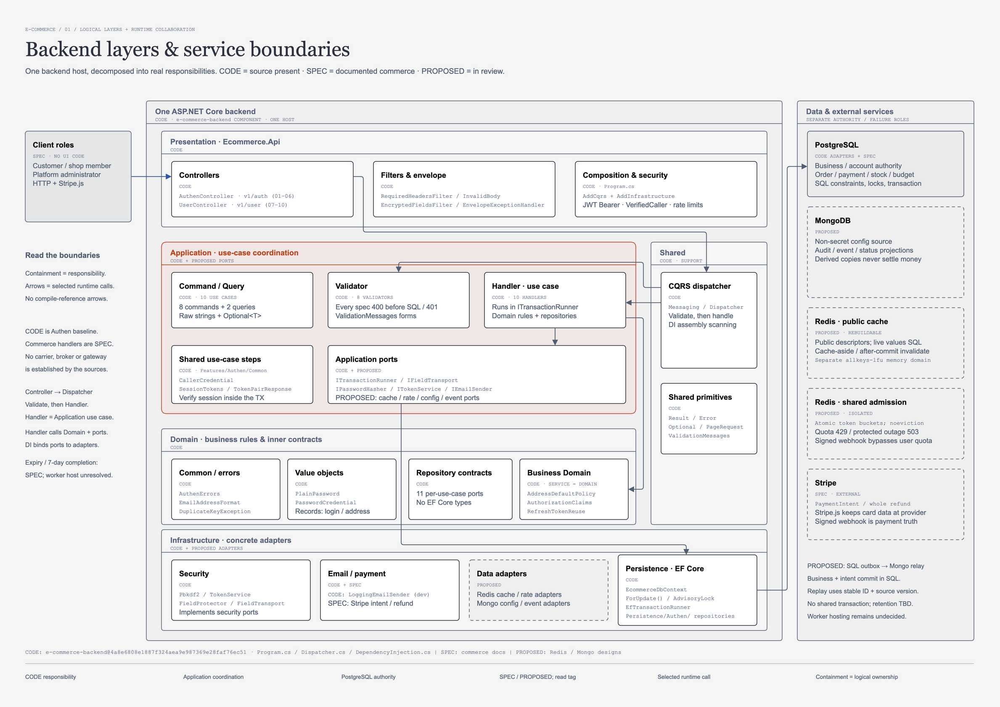
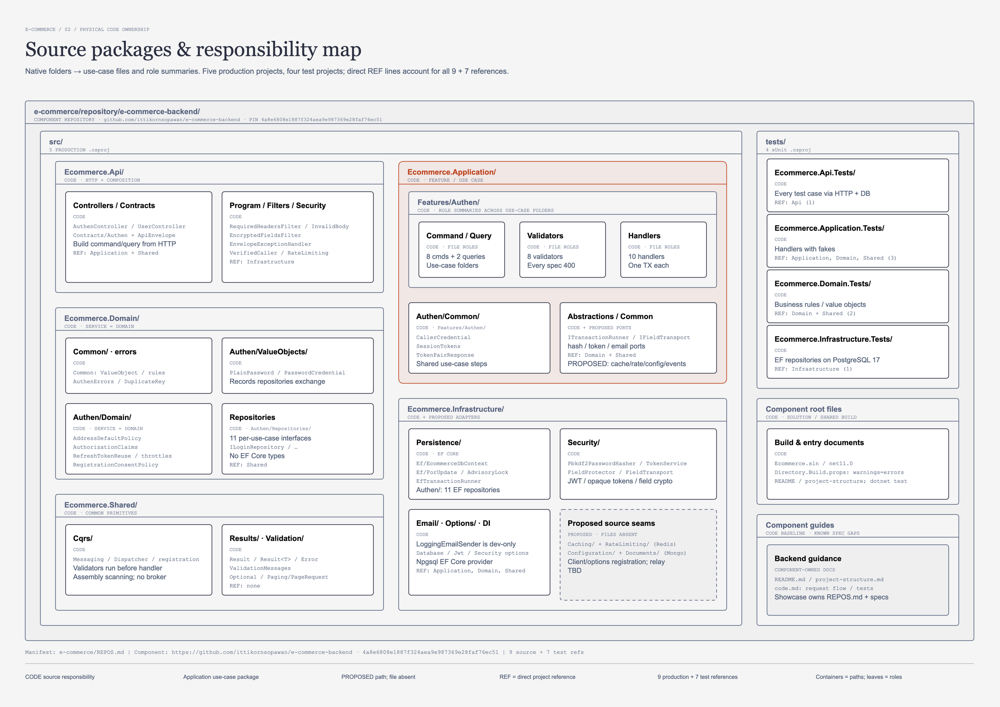
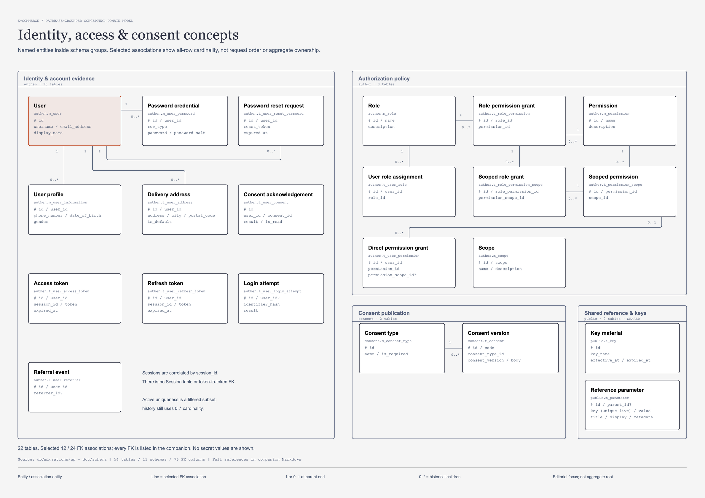

# E-commerce Code Structure: Every Layer and Sub-layer

## 1. Meaning and scope

This guide explains the e-commerce backend across **Presentation, Application, Domain, Infrastructure and Shared, including each layer's sub-layers**. It helps readers decide where code belongs, where its inputs come from, what work it owns and where its results go. The diagrams explain runtime collaboration, source ownership and business data concepts as distinct viewpoints.

### 1.1 Terms used across all layers

| Term | Meaning in this guide | Example |
| --- | --- | --- |
| Layer | A major responsibility and dependency boundary, separated into five production `.csproj` files | API handles HTTP; Domain owns business meaning and rules |
| Sub-layer | A responsibility group inside a layer, represented by folders or files; it does not introduce another project or process | Controllers and Contracts belong to API; the transaction runner and LINQ repositories belong to Persistence |
| Feature | A business capability grouping related rules and use cases | Authen |
| Use case / Handler | A use case is an operation requested by a caller and governed by one API spec; a handler is the Application class that coordinates it | Register (01) … InquiryUserAddress (10) |
| Contract / DTO | A data shape used across a boundary | HTTP request records, Command/Query inputs, response records |
| Port | An inner-layer interface describing a required capability without technology | `IUserAddressRepository`, `ITransactionRunner`, `IPasswordHasher` |
| Adapter | A technology-specific implementation of a port | `UserAddressRepository` (EF Core LINQ), `EfTransactionRunner`, `Pbkdf2PasswordHasher` |

### 1.2 Overview of all five layers

| Layer / project | Question it owns | Inputs and outputs | Sub-layers covered |
| --- | --- | --- | --- |
| Presentation — `Ecommerce.Api` | How is an HTTP request accepted and its outcome communicated? | HTTP request/principal → Application request → envelope with status and data | Controllers, Contracts, Filters/envelope, Security, Composition |
| Application — `Ecommerce.Application` | Which steps and collaborators complete this use case? | Command/Query → rule and port calls inside one transaction → `Result` | Commands/Queries, Validators, Handlers, Shared use-case steps, Ports/Common |
| Domain — `Ecommerce.Domain` | Which values and decisions does the business accept? | Business facts → decision or validity | Business Domain, ValueObjects, Repository contracts, Common/Errors |
| Infrastructure — `Ecommerce.Infrastructure` | How do the database, cryptography and external systems do the work? | Port calls → rows, hashes, tokens or translated failures | Repositories, Transaction runner, EF Core model, Locks, Security, Email, Options/DI |
| Shared — `Ecommerce.Shared` | Which mechanisms are common to every feature? | Request/result types → dispatch, results, messages, paging | Messaging, Dispatcher, Results/Errors, Validation messages, Optional/Paging |

These layers do not prescribe an API → Application → Domain → Infrastructure → Shared sequence for every request. Shared supplies building blocks referenced by several layers; runtime calls follow interfaces and DI. Section 3 distinguishes project references from runtime calls.

### 1.3 Convention, source baseline and evidence status

Within the Domain layer, this project uses **Service = Domain**: reusable business operations live in `src/Ecommerce.Domain/<Feature>/Domain/`, such as `Authen/Domain/`. Infrastructure services such as `TokenService` keep their technical responsibilities under their ports.

**Baseline:** the inspected code is [e-commerce-backend at `23fab92`](https://github.com/ittikornsopawan/e-commerce-backend/tree/23fab92ca6936aa905ec3470174f78c179ac6b8a), the `main` branch after the APIs 01–10 of authen-and-author, the removal of the legacy `api/authen/me` path (#18), the merge of the two auth controllers into `AuthenController` (#19) and the removal of the unused first-scaffold domain model (#20). [REPOS.md](../REPOS.md) still pins `61bedeb`; advancing the pin is a separate manifest change.

**Data access (owner decision 2026-11-18):** persistence uses EF Core + LINQ only, with no raw SQL in handlers or repositories. The specification SQL stays the reference for meaning: row locks, lock order, isolation and guarded updates are kept through `ForUpdate()`, the transaction runner and `ExecuteUpdateAsync`. The only raw statements are constant and input-free: the advisory lock and `SET TRANSACTION READ ONLY` (lead decision 2026-11-20). Dapper, `DbSession` and `UnitOfWork` were removed on 2026-11-20.

This document covers every layer/sub-layer, its responsibilities, inputs/outputs, collaboration and source examples. Describing a design does not approve new business behaviour; inspect the governing specification and its approval before implementation, following the [SDD workflow](../../.agents/workflows/spec-driven-development.md). The shared functions themselves are listed in the [Function Book](function-book.md).

## 2. Architecture: Responsibilities during request execution



[Full-size image](../diagram/main/architecture-design.drawio.png) · [Edit in draw.io](../diagram/main/architecture-design.drawio) · [Diagram companion](../diagram/main/architecture-design.md) · [HTML preview](../diagram/main/architecture-design.html)

This diagram explains logical layers and runtime collaboration within one ASP.NET Core application. Nested boxes identify responsibility ownership; arrows show selected calls. **The diagram was drawn from the first scaffold** and still shows `GetCurrentUser`, Dapper, `DbSession` and `UnitOfWork`, which no longer exist (its `AuthenController` box held the legacy `api/authen` routes; the class of that name now serves `v1/auth`); read its layer boxes, and take the sub-layer names from the tables below until the diagram is redrawn.

| Diagram label | Interpretation |
| --- | --- |
| `CODE` | Source exists for the element; behavioural completeness still requires comparison with its specification |
| `SPEC` | A document defines the behaviour; this label does not establish implementation |
| `PROPOSED` | An addition without implementation, such as Redis/MongoDB adapters and an outbox |
| `PROPOSED · OWNER REQUEST` | The owner-selected Business Domain position; it is now implemented (section 5) |

### 2.1 Presentation / API layer — HTTP boundary and system composition

API connects the caller to Application. It owns HTTP semantics, the request's shape, the verified caller and the dependency graph. Business decisions and I/O have other owners.

| Sub-layer | Responsibilities and owned work | Input → Output / collaboration | Source / status |
| --- | --- | --- | --- |
| Controllers | Define the `v1` routes, check the request's shape, build the Command/Query with the verified caller, dispatch it and choose the success status | HTTP action input → Application request → `Result` → envelope | `Controllers/AuthenController.cs` (`v1/auth`, specs 01–06), `Controllers/UserController.cs` (`v1/user`, 07–10) — CODE |
| Contracts | Request records for model binding; key-presence readers for partial updates and GET queries; the response envelope | JSON/query → records or present values; result → `{status, data}` | `Contracts/Authen/*`, `Contracts/JsonBody.cs`, `Contracts/QueryParameters.cs`, `Contracts/ApiEnvelope.cs` — CODE |
| Filters / envelope | Answer every API in the spec envelope around the controller: required headers (400 E10001), a body that cannot bind, unexpected exceptions (500 without bizCode) | Request/exception → 400/500 envelope | `Filters/RequiredHeadersFilter.cs`, `Filters/InvalidBody.cs`, `Filters/EnvelopeExceptionHandler.cs`, `Extensions/HttpEnvelope.cs`, `Extensions/ResultExtensions.cs` — CODE |
| Security | Read the verified JWT in the action (`VerifiedCaller`) instead of `[Authorize]`, so a 400 answers before a 401; per-IP rate limits of the public APIs (429 E90002) | Principal + Bearer header → `Caller?`; IP → permit or 429 | `Security/VerifiedCaller.cs`, `CallerClaims.cs`, `RateLimiting.cs` — CODE |
| Composition | Register controllers, filters, CQRS, Infrastructure and JWT Bearer (issuer, audience, key, UUID `sub`, 401 envelope on challenge); order rate limiter → authentication → controllers | Configuration → host and resolved services | `Program.cs` — CODE |

**Working example:** `UserController.UpsertAddress` reads the body with `JsonBody` (known keys, JSON kinds, which keys are present), passes `VerifiedCaller.Of(this)` and the present values into `UpsertUserAddressCommand`, then answers 201, 200 or 204 from the use case's outcome. It contains no SQL and no business rule.

**Boundary to preserve:** a valid JWT only proves the token's form and expiry. Whether its session is still open is checked inside the use case's transaction (section 2.8). Controllers never decide a business outcome.

Source: [UserController](https://github.com/ittikornsopawan/e-commerce-backend/blob/23fab92ca6936aa905ec3470174f78c179ac6b8a/src/Ecommerce.Api/Controllers/UserController.cs), [VerifiedCaller](https://github.com/ittikornsopawan/e-commerce-backend/blob/23fab92ca6936aa905ec3470174f78c179ac6b8a/src/Ecommerce.Api/Security/VerifiedCaller.cs), [RequiredHeadersFilter](https://github.com/ittikornsopawan/e-commerce-backend/blob/23fab92ca6936aa905ec3470174f78c179ac6b8a/src/Ecommerce.Api/Filters/RequiredHeadersFilter.cs), [Program](https://github.com/ittikornsopawan/e-commerce-backend/blob/23fab92ca6936aa905ec3470174f78c179ac6b8a/src/Ecommerce.Api/Program.cs)

### 2.2 Application layer — Use cases and orchestration sub-layers

Application accepts caller intent and completes a use case through Domain rules and ports. It owns step ordering, the transaction boundary and the outcome returned to API.

| Sub-layer | Responsibilities and owned work | Input → Output / collaboration | Source / status |
| --- | --- | --- | --- |
| Commands / Queries | Describe operation input; commands change state, queries read. Raw strings and `Optional<T>` keep "omitted" apart from "null" or "invalid" | Request record → handler contract returning `Result` or `Result<T>` | `Features/Authen/<UseCase>/*Command.cs`, `*Query.cs` — CODE (10 use cases) |
| Validators | Every 400 of the spec, before the JWT check and before SQL, with the message forms of `ValidationMessages` | Request → error list; the dispatcher stops before the handler | `*Validator.cs` — CODE (all use cases with input) |
| Handlers | Run the work in one transaction at the spec's isolation level, call Domain rules and repositories, map exceptions (409, 408) | Command/Query → `ITransactionRunner` → `Result` | `*Handler.cs` — CODE; each transaction body is a named private method |
| Shared use-case steps | The current-credential check (`CallerCredential.VerifyAsync` with the user lock for writes, `CheckAsync` without a lock for reads) and the token-pair issue (`SessionTokens`) | Caller → post-lock now or 401; user + session → token pair | `Features/Authen/Common/` — CODE |
| Ports / Common | Transaction, password, token and email capabilities; the shared timeout error | Interface calls → adapters bound in Infrastructure | `Abstractions/`, `Common/CommonErrors.cs`, `AssemblyReference.cs` — CODE |

**Working example:** `UpsertUserAddressCommandHandler` runs `ITransactionRunner.RunAsync(ReadCommitted, …)`. Inside it, `CallerCredential.VerifyAsync` locks the user and checks the stored token, the repository finds the owned address, `AddressQuota` and `AddressDefaultPolicy` decide the limit and the default, and the repository writes. A failure result rolls the transaction back.

**Boundary to preserve:** a handler coordinates; it does not copy a rule that Domain owns. Validators are synchronous and never read the database. Isolation and READ ONLY come from the spec, never from convenience.

Source: [UpsertUserAddressCommandHandler](https://github.com/ittikornsopawan/e-commerce-backend/blob/23fab92ca6936aa905ec3470174f78c179ac6b8a/src/Ecommerce.Application/Features/Authen/UpsertUserAddress/UpsertUserAddressCommandHandler.cs), [CallerCredential](https://github.com/ittikornsopawan/e-commerce-backend/blob/23fab92ca6936aa905ec3470174f78c179ac6b8a/src/Ecommerce.Application/Features/Authen/Common/Caller.cs), [ITransactionRunner](https://github.com/ittikornsopawan/e-commerce-backend/blob/23fab92ca6936aa905ec3470174f78c179ac6b8a/src/Ecommerce.Application/Abstractions/ITransactionRunner.cs)

### 2.3 Domain layer — Business rules and values

Domain expresses accepted business meaning: valid values and business decisions, separated from HTTP and storage.

| Sub-layer | Responsibilities and owned work | Input → Output / collaboration | Source / status |
| --- | --- | --- | --- |
| Business Domain — Service = Domain | Reusable decisions of the specs: effective grants, refresh-token reuse, the address default and quota, the registration consent rules, the reset-request and login throttles | Facts loaded by the handler → decision or `Result` | `Authen/Domain/` — CODE |
| ValueObjects | Values with their own rule (`PlainPassword`, `PasswordCredential`) and the records repositories exchange (registration, login, profile, address, refresh row, authorization facts) | Raw values → typed values or errors; records carry data only | `Authen/ValueObjects/` — CODE |
| Repository contracts | One interface per use case or shared step, named after the spec's queries | Typed values → asynchronous results; no EF Core types | `Authen/Repositories/` — CODE (11 interfaces) |
| Common / Errors | Rules shared by several features (`EmailAddressFormat`, `ProfileFieldRules`), the `ValueObject` base, the feature's errors and the persistence exceptions | Values → bool; failures → `Error` with the spec's status and bizCode | `Common/`, `Authen/AuthenErrors.cs`, `DuplicateKeyException.cs`, `MissingReferenceException.cs` — CODE |

**Working example:** `AddressDefaultPolicy.Resolve(rowStatus, requestedTrue, wasDefault, otherActiveExists)` returns whether the address is the default and whether the default must move to another address. The handler supplies the facts from the repository and applies the decision.

**Boundary to preserve:** there are no entities. Rows are read into records and decisions are pure functions over them; invariants that span requests are kept by the database (locks, guarded updates, unique indexes). Add an entity only when a spec needs behaviour that belongs to one object's state.

Source: [AddressDefaultPolicy](https://github.com/ittikornsopawan/e-commerce-backend/blob/23fab92ca6936aa905ec3470174f78c179ac6b8a/src/Ecommerce.Domain/Authen/Domain/AddressDefaultPolicy.cs), [AuthorizationClaims](https://github.com/ittikornsopawan/e-commerce-backend/blob/23fab92ca6936aa905ec3470174f78c179ac6b8a/src/Ecommerce.Domain/Authen/Domain/AuthorizationClaims.cs), [AuthenErrors](https://github.com/ittikornsopawan/e-commerce-backend/blob/23fab92ca6936aa905ec3470174f78c179ac6b8a/src/Ecommerce.Domain/Authen/AuthenErrors.cs)

### 2.4 Infrastructure layer — Adapters and technology details

Infrastructure performs the work behind the ports: EF Core persistence, transactions, cryptography and email.

| Sub-layer | Responsibilities and owned work | Input → Output / collaboration | Source / status |
| --- | --- | --- | --- |
| Repository adapters | Implement each Domain interface with EF Core LINQ; encrypt/decrypt personal fields; guarded updates with `ExecuteUpdateAsync` and row counts | Typed values → rows, counts or records | `Persistence/Authen/*Repository.cs`, `SessionRevocation.cs` — CODE |
| Transaction runner | Implement `ITransactionRunner`: begin at the requested isolation, optionally `SET TRANSACTION READ ONLY`, commit only a success `Result`, roll back otherwise; rerun the work on 40001 (3 attempts, then timeout); translate 23505, 23503 and timeouts | Isolation + work → committed `Result`, rollback, or a translated exception | `Persistence/EfTransactionRunner.cs` — CODE |
| EF Core model | Map the tables of the Showcase migrations to record classes with snake_case names; the migrations stay the schema source, EF never creates tables; every connection runs `Timezone=UTC` | LINQ → SQL commands and rows | `Persistence/Ef/EcommerceDbContext.cs`, `UserRecord.cs` — CODE |
| Locks | `query.ForUpdate()` appends `FOR UPDATE` through a query tag and interceptor; `AcquireTransactionLockAsync` takes a transaction advisory lock when no row exists to lock | Tagged query → locking SQL; key → held lock | `Persistence/Ef/ForUpdate.cs`, `AdvisoryLock.cs` — CODE |
| Security adapters | PBKDF2 password hashing, JWT and opaque tokens with SHA-256 hashes for storage, deterministic field encryption | Plain values → hashes, tokens, protected bytes | `Security/Pbkdf2PasswordHasher.cs`, `TokenService.cs`, `FieldProtector.cs` — CODE |
| Email adapter | Implement the email port; a development stub that logs a hand-off without the link | Reset email → log line | `Email/LoggingEmailSender.cs` — CODE, development-only |
| Options / DI | Read settings, validate keys at startup, bind ports with their lifetimes | Configuration → services | `Options/InfrastructureOptions.cs`, `DependencyInjection.cs` — CODE |
| Proposed data adapters | Caching, shared admission, configuration snapshots, event/projection stores | Ports to design → Redis/MongoDB | PROPOSED; absent from the source |

**Working example:** `UserAddressRepository.PromoteDefaultAsync` selects the most recently changed ACTIVE address and updates it with a guard on its status. The user row lock that `CallerCredential` took makes the select and the update atomic for that user.

**Boundary to preserve:** repositories and the DbContext are scoped; security and email services are singletons and never capture a scoped context. No repository opens its own transaction.

Source: [EfTransactionRunner](https://github.com/ittikornsopawan/e-commerce-backend/blob/23fab92ca6936aa905ec3470174f78c179ac6b8a/src/Ecommerce.Infrastructure/Persistence/EfTransactionRunner.cs), [UserAddressRepository](https://github.com/ittikornsopawan/e-commerce-backend/blob/23fab92ca6936aa905ec3470174f78c179ac6b8a/src/Ecommerce.Infrastructure/Persistence/Authen/UserAddressRepository.cs), [ForUpdate](https://github.com/ittikornsopawan/e-commerce-backend/blob/23fab92ca6936aa905ec3470174f78c179ac6b8a/src/Ecommerce.Infrastructure/Persistence/Ef/ForUpdate.cs), [DependencyInjection](https://github.com/ittikornsopawan/e-commerce-backend/blob/23fab92ca6936aa905ec3470174f78c179ac6b8a/src/Ecommerce.Infrastructure/DependencyInjection.cs)

### 2.5 Shared layer — Common request and result mechanisms

Shared supplies types used across features and has no project references.

| Sub-layer | Responsibilities and owned work | Input → Output / collaboration | Source / status |
| --- | --- | --- | --- |
| Messaging contracts | Request, command/query, handler, validator and dispatcher interfaces | Command/Query type → handler/validator contracts | `Cqrs/Messaging.cs` — CODE |
| Dispatcher / registration | Scan Application for handlers and validators; run validators before the handler | Request → validation failure or the handler's result | `Cqrs/Dispatcher.cs`, `CqrsServiceCollectionExtensions.cs` — CODE |
| Results / Errors | Success/failure and the error vocabulary; `Error.Of` guards which bizCodes a type may carry | Value/error → `Result`, `Error` | `Results/Result.cs`, `Error.cs` — CODE |
| Validation messages | The 400 texts of api-conventions, built once for every API | Field/rule/position → `bizMessage` | `Validation/ValidationMessages.cs` — CODE |
| Optional / paging | `Optional<T>` (omitted vs null) and checked offset pagination (`PageRequest`, `Page<T>`) | Raw input → typed values and totals | `Optional.cs`, `Paging/PageRequest.cs` — CODE |

**Boundary to preserve:** Shared does not map HTTP, open transactions or authorize requests. Additions must keep it free of project references.

Source: [Dispatcher](https://github.com/ittikornsopawan/e-commerce-backend/blob/23fab92ca6936aa905ec3470174f78c179ac6b8a/src/Ecommerce.Shared/Cqrs/Dispatcher.cs), [Error](https://github.com/ittikornsopawan/e-commerce-backend/blob/23fab92ca6936aa905ec3470174f78c179ac6b8a/src/Ecommerce.Shared/Results/Error.cs), [ValidationMessages](https://github.com/ittikornsopawan/e-commerce-backend/blob/23fab92ca6936aa905ec3470174f78c179ac6b8a/src/Ecommerce.Shared/Validation/ValidationMessages.cs)

### 2.6 Existing request flow

```text
HTTP request
  -> rate limiter (public APIs) -> JWT middleware (form and expiry only)
  -> RequiredHeadersFilter -> model binding (InvalidBody)
  -> Controller checks the shape, builds the Command / Query with VerifiedCaller
  -> Dispatcher runs the validator
       -> errors: 400 without invoking the Handler
       -> valid: invoke the Handler
  -> Handler: ITransactionRunner.RunAsync(isolation, readOnly)
       -> CallerCredential (protected APIs) -> Domain rules -> repositories (EF Core LINQ)
       -> success commits, failure rolls back
  -> Controller: ToSuccess / ToFailure envelope; unexpected exception -> 500 envelope
```

### 2.7 Business Domain flow under the selected convention

```text
Handler loads the facts the rule needs (inside the transaction, under the spec's locks)
  -> calls a business operation in <Feature>/Domain/
  -> Domain returns a decision or a Result
  -> Handler applies it through repository ports
  -> Infrastructure writes with guarded LINQ updates
```

### 2.8 Responsibilities spanning layers

| Concern | Responsibility split across sub-layers | What to verify together |
| --- | --- | --- |
| Validation | API checks the request's shape and headers; Application validators check every value rule of the spec; Domain supplies shared value rules | Every 400 answers before SQL and before the 401 |
| Authentication | API middleware verifies the JWT; `VerifiedCaller` hands it to the use case; `CallerCredential` checks inside the transaction that the user is ACTIVE and the stored token is current | Logout and a password reset end a session at once; no endpoint trusts the JWT alone |
| Transaction / concurrency | The handler chooses the spec's isolation and read-only flag; repositories lock with `ForUpdate()` or an advisory lock; the runner retries 40001 | Lock order, guarded updates and zero-row outcomes agree with the sequence diagram |
| Expected failure / HTTP | Domain declares the errors; Application chooses the outcome; Shared carries it; API maps type → status and bizCode | A 500 never leaks its description |
| Dependency composition | `Program` calls `AddCqrs` and `AddInfrastructure`; inner layers use only interfaces | A runtime call to an adapter does not create a project reference |

## 3. Repository: Source ownership and allowed project references



[Full-size image](../diagram/reference/repository/repository-architecture.drawio.png) · [draw.io source](../diagram/reference/repository/repository-architecture.drawio) · [Diagram companion](../diagram/reference/repository/repository-architecture.md) · [HTML preview](../diagram/reference/repository/repository-architecture.html)

This diagram maps source ownership and compile-time dependencies. `REF` indicates a `ProjectReference`. Like section 2's diagram it was drawn from the first scaffold (`IAuthenRepositories`, Dapper, `DbSession`, `UnitOfWork`, two test projects); the project boxes and references are still right, the file names inside them are not.

### 3.1 Two repository boundaries

```text
Showcase: system-analysis-and-design/
└── e-commerce/
    ├── REPOS.md                 # identity / remote / pinned revision
    ├── api/                     # API contract
    ├── db/                      # migrations and database tests
    ├── doc/                     # specifications, this guide, the Function Book
    ├── diagram/                 # diagram bundles
    └── repository/
        ├── .gitkeep
        └── e-commerce-backend/   # independent Git clone; ignored by Showcase
            ├── .git/
            ├── Ecommerce.sln
            ├── Directory.Build.props
            ├── README.md
            ├── project-structure.md
            ├── code.md
            ├── src/
            └── tests/
```

Change backend code and deliver its commits/PRs to the component remote. The manifest, specifications, diagrams and this guide belong to Showcase. To advance the baseline, deliver and verify the component commit on its remote before changing the manifest's `revision`. Never stage child code or its `.git` in Showcase.

### 3.2 Observed project references

| Project | Referenced projects |
| --- | --- |
| `Ecommerce.Api` | Application, Infrastructure, Shared |
| `Ecommerce.Application` | Domain, Shared |
| `Ecommerce.Domain` | Shared |
| `Ecommerce.Infrastructure` | Application, Domain, Shared |
| `Ecommerce.Shared` | No project references |
| `Ecommerce.Domain.Tests` | Domain, Shared |
| `Ecommerce.Application.Tests` | Application, Domain, Shared |
| `Ecommerce.Infrastructure.Tests` | Infrastructure |
| `Ecommerce.Api.Tests` | Api (and the Infrastructure test fixtures as linked files) |

The source contains 9 production references and 7 test references. Domain and Application do not reference Infrastructure. Infrastructure exposes its internals only to the two database test projects (`InternalsVisibleTo`).

## 4. Organizing code by feature and use case

Application groups code under `Features/<Feature>/<UseCase>/`, placing use-case input, validator, handler and output together:

```text
Ecommerce.Application/
├── Abstractions/
│   ├── ITransactionRunner.cs
│   ├── IPasswordHasher.cs
│   ├── ITokenService.cs
│   └── IEmailSender.cs          # + the settings records the handlers read
├── Common/CommonErrors.cs
└── Features/Authen/
    ├── Common/                  # Caller, CallerCredential, SessionTokens, TokenPairResponse
    ├── Register/                # 01: command, validator, handler, response
    ├── Login/                   # 02
    ├── ResetPassword/           # 03: request a reset link
    ├── CreateNewPassword/       # 04
    ├── RefreshToken/            # 05
    ├── Logout/                  # 06
    ├── UpsertUserProfile/       # 07
    ├── GetUserProfile/          # 08
    ├── UpsertUserAddress/       # 09
    └── InquiryUserAddress/      # 10
```

| Part | Responsibility |
| --- | --- |
| Command / Query | Input record expressing the operation, without HTTP or SQL |
| Validator | Every 400 of the spec, with the shared message forms |
| Handler | Coordinate steps inside one transaction; call Domain rules and ports; map expected exceptions |
| Response | The spec's `data` object, never a Domain record directly |
| Abstractions | Ports for transactions, hashing, tokens and email |

Use cases do not all need the same files: logout and reset return a `Result` without data; 08 has no validator because it accepts no input.

## 5. Service = Domain: Reusable business operations

```text
Ecommerce.Domain/
├── Common/                  # ValueObject, EmailAddressFormat, ProfileFieldRules
├── DuplicateKeyException.cs, MissingReferenceException.cs
└── Authen/
    ├── Domain/              # CODE: reusable Authen business operations
    ├── ValueObjects/        # CODE: PlainPassword, PasswordCredential and data records
    ├── Repositories/        # CODE: one interface per use case or shared step
    └── AuthenErrors.cs
```

### 5.1 What Domain should own

- Make business decisions from facts the handler supplies: grants from authorization facts, the reuse class of a refresh token, the address default.
- Group operations reused across use cases so handlers apply one rule set.
- Return decisions or failures that Application uses in its next step.

Domain does not accept EF Core contexts, HTTP DTOs or SDK clients, and does not commit.

### 5.2 Dividing work between Handler and Domain

| Question | Primary owner |
| --- | --- |
| Which steps, locks and ports complete this request, and what does the caller receive? | Application handler |
| What do these facts permit, or what should be decided? | Feature `Domain/` |
| Is this value valid? | ValueObject or a Common rule |
| Which rows are read/written, under which lock? | Infrastructure through ports |
| How is the result translated into HTTP? | API |

### 5.3 Observed rules

| Rule | Location | Spec |
| --- | --- | --- |
| Effective grants and claim names | `AuthorizationClaims` | 02 login |
| Brute-force limit | `LoginThrottle` (with an advisory lock per identifier) | 02 login |
| Reset-request limit | `PasswordResetThrottle` | 03 reset password |
| Refresh-token rotate / replay / invalid | `RefreshTokenReuse` | 05 refresh token |
| Consent and referrer checks of a registration | `RegistrationConsentPolicy` | 01 register |
| One ACTIVE default address, at most 10 addresses | `AddressDefaultPolicy`, `AddressQuota` | 09 upsert user address |
| Email, phone, date-of-birth and gender formats | `EmailAddressFormat`, `ProfileFieldRules` | 01, 03, 07 |
| Single use across requests (reset token, refresh token) | Guarded `ExecuteUpdateAsync` under the user lock | 04, 05 |

Source: [Authen/Domain](https://github.com/ittikornsopawan/e-commerce-backend/tree/23fab92ca6936aa905ec3470174f78c179ac6b8a/src/Ecommerce.Domain/Authen/Domain)

## 6. CQRS and Business Domain calls

| Side | Current use cases | Relationship to Business Domain |
| --- | --- | --- |
| Command | Register, Login, RequestPasswordReset, CreateNewPassword, RefreshToken, Logout, UpsertUserProfile, UpsertUserAddress | Handlers call `Domain/` operations under the spec's locks |
| Query | GetUserProfile, InquiryUserAddress | Read in a REPEATABLE READ READ ONLY transaction with their own read repositories |

Login and refresh are commands even though they return tokens, because they write token rows. The two queries use read-only repository ports (`IUserProfileQueryRepository`, `IUserAddressQueryRepository`) separate from the write ports.

Dispatcher invokes validators before handlers and skips the handler when errors exist. Transactions remain the handler's responsibility; the `ICommand` and `IQuery` markers do not provide them.

## 7. Infrastructure and correctness across requests

| Port / responsibility | Implementation |
| --- | --- |
| Repositories | EF Core LINQ repositories in `Persistence/Authen/` over `EcommerceDbContext` |
| Transaction coordination | `ITransactionRunner` → `EfTransactionRunner` (isolation, READ ONLY, 40001 retry, exception translation) |
| Row and key locks | `ForUpdate()`; `AcquireTransactionLockAsync` |
| Password hashing | `Pbkdf2PasswordHasher` |
| JWT and opaque tokens | `TokenService` |
| Personal-field protection | `FieldProtector` |
| Reset email | `LoggingEmailSender` (development stub) |

Rules that must hold across requests are enforced by the database, not by an object in memory: the user row lock serialises one user's changes, guarded updates (`WHERE row_status = 'ACTIVE'` and a row count) make a token single-use, and unique indexes reject duplicates that the runner translates into the spec's 409.

## 8. Identity domain model: Data concepts used by business code



[Full-size image](../diagram/domain/domain-identity-model.drawio.png) · [draw.io source](../diagram/domain/domain-identity-model.drawio) · [Explanation and SQL traceability](../diagram/domain/domain-identity-model.md) · [HTML preview](../diagram/domain/domain-identity-model.html)

This diagram is a conceptual interpretation of the schema. Its association edges have different meanings from the runtime arrows and project references of the earlier diagrams.

- User, Credential, Reset request, Profile, Address, Token and Login attempt are data concepts. The code has no entity classes for them; repositories read rows into records.
- The `authen` box groups concepts by schema; it does not define one aggregate.
- Role, Permission, Scope and grant associations are what `AuthorizationClaims` resolves into JWT claims at login.
- Session correlation uses `session_id` in the token tables; there is no session table.
- Cardinality includes historical rows; use the partial unique constraints for permitted ACTIVE-row counts.

## 9. Implemented elements and remaining designs

| Area | Status in the component | How to use the guide and diagrams |
| --- | --- | --- |
| Five production projects / four test projects | Present | Reference layout and dependencies |
| authen-and-author APIs 01–10 | Present, every test case of each spec automated | Trace code flow; the spec stays the authority |
| `Authen/Domain/` business operations | Present (section 5.3) | Reuse before adding a rule |
| Product, order, payment, shipping and the other domains | Specified in Showcase; no implementation | Inspect the specs and their approval before development |
| Redis/MongoDB adapters, outbox/relay | Design approved 2026-11-16; no implementation | Keep separate from CODE until implemented |
| Diagrams of sections 2 and 3 | Drawn from the first scaffold | Redraw pending; the tables in this guide are current |

## 10. Tests and checks for business-operation development

| Test project | Tested behaviour | Dependencies / limitations |
| --- | --- | --- |
| `Ecommerce.Domain.Tests` | Business rules (`AuthorizationClaims`, `RefreshTokenReuse`, `AddressDefaultPolicy`, consent policy, field rules) and value objects | No database |
| `Ecommerce.Application.Tests` | Handlers with fakes: step order, isolation, read-only flag, exception mapping | No database; does not prove locks |
| `Ecommerce.Infrastructure.Tests` | Repositories and the transaction runner on a throw-away PostgreSQL 17 loaded with every Showcase migration | Needs `initdb`/`pg_ctl` |
| `Ecommerce.Api.Tests` | Every case of each API's `test-cases.md` through the HTTP pipeline and the real database; test names start with the case ID | Needs PostgreSQL 17 like above |

When developing a business operation under an approved specification, check at least:

1. Write the API's `test-cases.md` with api-test-case-creator and automate every case.
2. Assign each rule to `Domain/` or a value object; keep the handler to coordination.
3. Give every state change a lock or guard that a database test proves, and check it with a mutation (remove the guard, see the test fail).
4. Keep queries free of writes (READ ONLY when the spec says so).
5. Pass the dev-like-principal code gate: Function Book first, methods ≤ 30 lines, `dotnet format`, the quality report in the PR.
6. Update this guide, the Function Book and the relevant diagrams to the actual status.

## 11. References and guide verification

- [Function Book](function-book.md) lists the shared functions with their signatures and use.
- [Component project-structure.md](https://github.com/ittikornsopawan/e-commerce-backend/blob/23fab92ca6936aa905ec3470174f78c179ac6b8a/project-structure.md) lists the files and the steps to add a use case.
- [Component code.md](https://github.com/ittikornsopawan/e-commerce-backend/blob/23fab92ca6936aa905ec3470174f78c179ac6b8a/code.md) (Thai) explains the request flow, transactions, errors and tests.
- [Diagram index](../diagram/README.md) covers other views such as order lifecycle and checkout/payment sequences.
- [Manifest](../REPOS.md) and [component-repositories rule](../../.agents/rules/component-repositories.md) define Git ownership and baseline pinning.

### 11.1 Verification — 20 November 2026

| Check | Result and scope |
| --- | --- |
| Source correspondence | Every file, class and route named here exists at component `23fab92`; the project references in 3.2 come from the `.csproj` files |
| Removed elements | `GetCurrentUser`, Dapper, `DbSession`, `UnitOfWork`, the `User`/`PasswordResetToken` entities and their value objects are named only as removed or as labels of the old diagrams |
| Diagrams | The three bundles are unchanged; sections 2 and 3 say which labels are outdated |
| Component tests | `dotnet test` at `23fab92`: Api 278, Application 43, Domain 73, Infrastructure 47, 0 failed |

This revision replaces the 2026-11-09 review of the first scaffold. It changes no backend code, specification, schema or diagram, and needs the lead's review before it is approved again.
