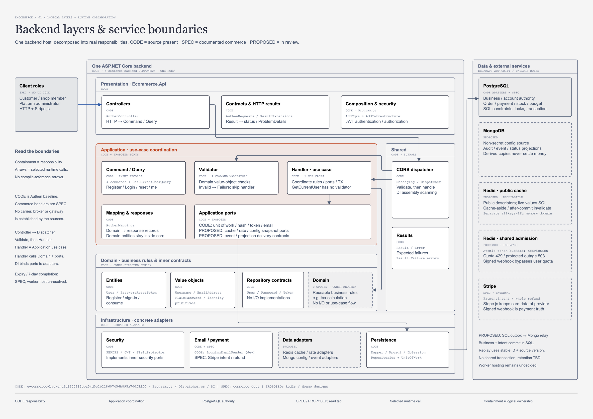
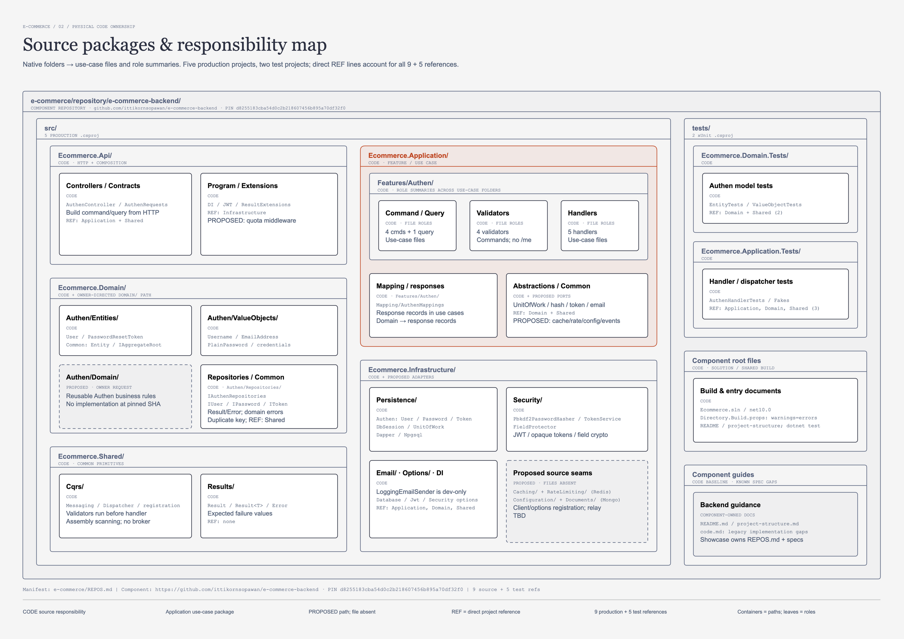
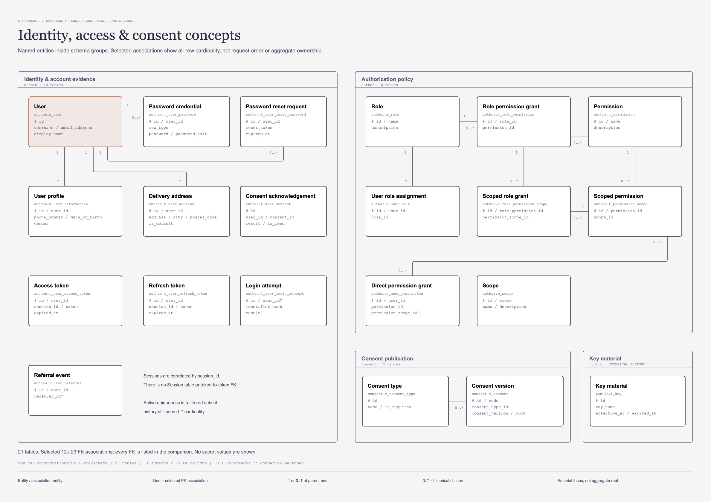

# โครงสร้างโค้ด E-commerce และตำแหน่ง Business Domain

## 1. ความหมายและขอบเขต

เอกสารนี้ใช้คำว่า **Service = Domain** ตามที่เจ้าของโครงการกำหนด หมายถึงส่วนของโค้ดที่ทำ business logic หรือ business operations ที่นำไปใช้ซ้ำได้ โดยวางอยู่ใน Domain layer และใช้ชื่อโฟลเดอร์ **`Domain/`** ภายใต้ feature เช่น:

```text
e-commerce/repository/e-commerce-backend/
└── src/Ecommerce.Domain/Authen/Domain/
```

คำว่า Domain ในเอกสารนี้จึงต้องอ่านตามบริบท:

| ชื่อ | ความหมาย |
| --- | --- |
| `Ecommerce.Domain` | C# project ของ Domain layer รวม business operations, entities, value objects และ inner contracts |
| `Authen/Domain/` | ส่วนเก็บ business operations ของ Authen ตาม owner convention; หน้าที่เดียวกับที่เรียก business service/domain service ในการคุยนี้ |
| Entity / ValueObject | โมเดลและกฎที่เป็นเจ้าของ state หรือค่าของตัวเอง ใช้ร่วมกับ business operations ได้ |
| Domain model diagram | ภาพแนวคิดและความสัมพันธ์ของข้อมูลธุรกิจ ไม่ใช่รายชื่อ business service classes หรือ runtime calls |

ชื่อ infrastructure services อย่าง `TokenService` หรือ email sender ยังมีหน้าที่ทางเทคนิคตาม implementation ของตนเอง การใช้ Service = Domain ในที่นี้ไม่ได้ย้ายทุกคลาสที่ลงท้ายด้วย Service มาเป็น business logic

**Baseline:** โค้ดที่ตรวจคือ Component Repository [e-commerce-backend](https://github.com/ittikornsopawan/e-commerce-backend/tree/d8255183cba54d0c2b218607456b895a70df32f0) ตาม [REPOS.md](../REPOS.md) โดยมี Authen ห้า use cases ส่วน `Authen/Domain/` เป็นตำแหน่งที่เจ้าของกำหนดสำหรับ design แต่ยังไม่พบ implementation ใน commit นี้

คู่มือนี้ยังเป็น draft สำหรับ review การเขียนคำอธิบายหรือแสดงกล่องในภาพไม่ได้อนุมัติ implementation ของ business behavior ใหม่ ต้องอ่าน governing spec และ approval ก่อนพัฒนาตาม [SDD workflow](../../.agents/workflows/spec-driven-development.md)

## 2. Architecture: ขณะ request ทำงาน แต่ละส่วนรับผิดชอบอะไร



[เปิดภาพขนาดเต็ม](../diagram/main/architecture-design.drawio.png) · [แก้ไขด้วย draw.io](../diagram/main/architecture-design.drawio) · [คำอธิบายภาพ](../diagram/main/architecture-design.md) · [HTML preview](../diagram/main/architecture-design.html)

ภาพนี้อธิบาย logical layers และ runtime collaboration ภายใน ASP.NET Core backend หนึ่งแอปพลิเคชัน กรอบที่ซ้อนกันบอกเจ้าของความรับผิดชอบ ส่วนลูกศรแสดงการเรียกที่เลือกมาอธิบาย ไม่ใช่ compile-time project references หรือคำสั่งให้ทุก request ผ่านทุกกล่อง

| ป้ายในภาพ | วิธีอ่าน |
| --- | --- |
| `CODE` | มี source รองรับส่วนที่ระบุใน pinned backend; ยังต้องตรวจความครบของพฤติกรรมกับ spec |
| `SPEC` | มีเอกสารกำหนด behavior ต้องตรวจ approval ของเอกสารนั้น ไม่ได้แปลว่า backend implement แล้ว |
| `PROPOSED` | ส่วนที่เสนอเพิ่ม ยังไม่ใช่ implementation เช่น Redis/MongoDB adapters และ outbox |
| `PROPOSED · OWNER REQUEST` | เจ้าของกำหนดตำแหน่ง Business Domain ในภาพแล้ว แต่ pinned source ยังไม่มีโฟลเดอร์/คลาสดังกล่าว |

### 2.1 หน้าที่ของแต่ละ layer

| Layer | เป็นเจ้าของอะไร | ตัวอย่างที่มีในโค้ด |
| --- | --- | --- |
| Presentation — `Ecommerce.Api` | HTTP contracts, controller, response mapping, authentication wiring และ DI composition | `AuthenController`, `AuthenRequests`, `ResultExtensions`, `Program` |
| Application — `Ecommerce.Application` | command/query, request validation, handler orchestration, transaction coordination และ response DTOs | Authen handlers, validators, `AuthenMappings`, `IUnitOfWork` |
| Domain — `Ecommerce.Domain` | business meaning, reusable business operations ตาม convention, entity/value invariants และ repository interfaces | `User`, `PasswordResetToken`, value objects, `IAuthenRepositories` |
| Infrastructure — `Ecommerce.Infrastructure` | SQL, connection/transaction implementation, cryptography, JWT, field encryption และ external adapters | Dapper repositories, `DbSession`, `UnitOfWork`, hasher, `TokenService`, email stub |
| Shared — `Ecommerce.Shared` | building blocks ร่วมของ dispatch และ expected results | `ICommand`, `IQuery`, `Dispatcher`, `Result`, `Error` |

### 2.2 เส้นทางที่มีอยู่แล้ว

```text
HTTP request
  -> Controller สร้าง Command / Query
  -> Dispatcher เรียก validators ที่ลงทะเบียน
       -> มี validation error: คืน failure และไม่เรียก Handler
       -> ผ่าน: เรียก Handler
  -> Handler ใช้ Entity / ValueObject และ repository/security ports
  -> Infrastructure ทำ I/O และ SQL
  -> Handler map เป็น response
  -> Controller คืน HTTP response
```

มี validators ของสี่ commands ส่วน `GetCurrentUserQuery` ไม่มี validator ใน baseline Dispatcher ไม่ได้เปิด transaction หรือเพิ่ม authorization/retry policy ให้อัตโนมัติ

### 2.3 เส้นทาง Business Domain ตาม convention ที่กำหนด

```text
Handler โหลดข้อเท็จจริงที่ use case ต้องใช้
  -> เรียก business operation ใน <Feature>/Domain/
  -> Domain ใช้กฎร่วมกับ Entity / ValueObject และคืน business result
  -> Handler ประสานการบันทึกผ่าน ports / transaction boundary
  -> Infrastructure จัดการ SQL / external systems
```

ส่วน `Handler -> Authen/Domain/` ยังเป็น owner-directed design ตามเส้นและป้ายในภาพ ไม่ใช่ call ที่พบแล้วใน pinned source Handler ยังคงเป็น Application use case ขณะที่ Domain เป็นส่วนทำ business logic ที่นำไปใช้ซ้ำได้ ไม่ใช่ backend service ที่ deploy แยก

## 3. Repository: โค้ดอยู่ตรงไหน และ project ใดอ้างอิงกันได้



[เปิดภาพขนาดเต็ม](../diagram/reference/repository/repository-architecture.drawio.png) · [draw.io source](../diagram/reference/repository/repository-architecture.drawio) · [คำอธิบายภาพ](../diagram/reference/repository/repository-architecture.md) · [HTML preview](../diagram/reference/repository/repository-architecture.html)

ภาพนี้เป็นแผนที่ source ownership และ compile-time dependencies ซึ่งเป็นคนละมุมกับ runtime architecture เส้น `REF` แปลว่ามี `ProjectReference` ใน `.csproj` การมี runtime call ผ่าน interface ไม่ได้ทำให้ project ชั้นในต้องอ้างอิง concrete Infrastructure

### 3.1 ขอบเขตสอง repositories

```text
Showcase: system-analysis-and-design/
└── e-commerce/
    ├── REPOS.md                 # identity / remote / pinned revision
    ├── api/                     # API contract
    ├── db/                      # migrations และ database tests
    ├── doc/                     # specifications และคู่มือฉบับนี้
    ├── diagram/                 # diagram bundles
    └── repository/
        ├── .gitkeep
        └── e-commerce-backend/   # independent Git clone; Showcase ignore
            ├── .git/
            ├── Ecommerce.sln
            ├── Directory.Build.props
            ├── README.md
            ├── project-structure.md
            ├── code.md
            ├── src/
            └── tests/
```

แก้ backend code และส่ง commit/PR ที่ remote ของ component ส่วน manifest/specifications/diagrams และเอกสารฉบับนี้เป็นของ Showcase เมื่อจะเลื่อน baseline ให้ส่งมอบและ verify component commit บน remote ก่อนปรับ `revision` ใน manifest ห้าม stage child code หรือ child `.git` เข้าฝั่ง Showcase

### 3.2 Project references ที่พบจริง

| Project | อ้างอิง projects |
| --- | --- |
| `Ecommerce.Api` | Application, Infrastructure, Shared |
| `Ecommerce.Application` | Domain, Shared |
| `Ecommerce.Domain` | Shared |
| `Ecommerce.Infrastructure` | Application, Domain, Shared |
| `Ecommerce.Shared` | ไม่มี project reference |
| `Ecommerce.Domain.Tests` | Domain, Shared |
| `Ecommerce.Application.Tests` | Application, Domain, Shared |

รวม 9 production references และ 5 test references ตาม source ที่ pin Domain และ Application ไม่ reference Infrastructure ส่วน Shared มี DI abstractions package อยู่แล้ว คำว่าไม่มี project reference จึงไม่ได้แปลว่าไม่มี external-package dependency

`Authen/Domain/` อยู่ภายใน `Ecommerce.Domain.csproj` เดิม การใช้โฟลเดอร์นี้จึงไม่ได้เพิ่ม project หรือเปลี่ยน dependency graph ด้วยตัวมันเอง

## 4. การจัดโค้ดตาม feature และ use case

Application จัดกลุ่ม `Features/<Feature>/<UseCase>/` เพื่อให้ input, validator, handler และ output ของ use case อยู่ใกล้กัน ตัวอย่าง Authen ปัจจุบัน:

```text
Ecommerce.Application/
├── Abstractions/
│   ├── IUnitOfWork.cs
│   ├── IPasswordHasher.cs
│   ├── ITokenService.cs
│   └── IEmailSender.cs
└── Features/Authen/
    ├── Register/
    │   ├── RegisterCommand.cs
    │   ├── RegisterCommandValidator.cs
    │   ├── RegisterCommandHandler.cs
    │   └── RegisterResponse.cs
    ├── Login/
    ├── ResetPassword/       # request link และ confirm เป็นคนละ command/handler
    ├── GetCurrentUser/
    └── Mapping/AuthenMappings.cs
```

| ส่วน | หน้าที่และตัวอย่าง |
| --- | --- |
| Command / Query | input record ระบุเจตนาของ operation โดยไม่รับผิดชอบ HTTP หรือ SQL |
| Validator | ตรวจ request constraints; เรียก value-object factories สำหรับกฎค่าที่มีอยู่แล้ว |
| Handler | ประสานขั้นตอน โหลดข้อมูล เรียก business/model behavior และ ports จัด transaction ตาม use case |
| Response / Mapping | แปลงผลเป็น DTO ที่ caller ใช้ ไม่คืน domain entity ออกตรง ๆ |
| Application abstractions | ports สำหรับ transaction, hashing, token issuing และ email โดยไม่ import concrete adapter |

ไม่จำเป็นต้องมีไฟล์เหมือนกันทุก use case: `Register` และ `Login` คืน typed response, request/confirm reset คืน `Result` ไม่มี response DTO เฉพาะ ส่วน query `/me` คืน `CurrentUserResponse` และไม่มี validator เฉพาะ

ดู source: [RegisterCommandHandler](https://github.com/ittikornsopawan/e-commerce-backend/blob/d8255183cba54d0c2b218607456b895a70df32f0/src/Ecommerce.Application/Features/Authen/Register/RegisterCommandHandler.cs), [LoginCommandHandler](https://github.com/ittikornsopawan/e-commerce-backend/blob/d8255183cba54d0c2b218607456b895a70df32f0/src/Ecommerce.Application/Features/Authen/Login/LoginCommandHandler.cs), [AuthenMappings](https://github.com/ittikornsopawan/e-commerce-backend/blob/d8255183cba54d0c2b218607456b895a70df32f0/src/Ecommerce.Application/Features/Authen/Mapping/AuthenMappings.cs)

## 5. Service = Domain: ที่เก็บ business operations

โครงสร้างของ feature ใน Domain layer ให้อ่านตามนี้ โดยบรรทัด `Domain/` เป็นตำแหน่งตาม owner convention ที่ยังไม่มีใน source baseline:

```text
Ecommerce.Domain/
├── Common/                  # Entity, ValueObject, IAggregateRoot
└── Authen/
    ├── Entities/            # CODE: User, PasswordResetToken
    ├── ValueObjects/        # CODE: business values และกฎของค่า
    ├── Repositories/        # CODE: IUser/IPassword/ITokenRepository
    ├── Domain/              # OWNER CONVENTION: reusable Authen business operations
    │                        # ยังไม่ implement ที่ pinned revision
    ├── AuthenErrors.cs
    └── UserStatus.cs
```

### 5.1 Domain ควรรับผิดชอบอะไร

- ใช้กฎและตัดสินผลทางธุรกิจจากข้อมูลที่จำเป็น เช่นประเมิน business condition หรือคำนวณผลจาก business values/policy
- รวม operation ที่ต้องใช้ซ้ำระหว่าง use cases เพื่อให้ handlers ใช้กฎชุดเดียวกัน
- ทำงานร่วมกับ entity/value object โดยคงเจ้าของ invariant ที่ชัดเจน
- คืน business result หรือ failure ที่ Application นำไปทำขั้นตอนต่อได้

ข้อมูลภายนอกที่จำเป็นต่อกฎให้ Handler โหลดแล้วส่งเข้า Domain ตาม contract ที่ออกแบบ หรือใช้งานผ่าน inner abstraction ที่อนุมัติไว้ Domain ไม่รับ concrete SQL connection, Redis/MongoDB client หรือ HTTP request DTO และไม่เป็นเจ้าของ SQL commit

ตัวอย่าง “คำนวณภาษี” อธิบายประเภทของ reusable business operation เท่านั้น ต้องอยู่ใน feature ที่เป็นเจ้าของกฎการเงินจริง เอกสารนี้ไม่ได้เพิ่ม tax class ใน Authen หรือกำหนดอัตรา สูตร และการปัดเศษ

### 5.2 Handler และ Domain แบ่งงานอย่างไร

| คำถาม | เจ้าของหลัก |
| --- | --- |
| request นี้ต้องทำขั้นตอนใด เรียก ports ใด และตอบ caller อย่างไร | Application Handler |
| กฎธุรกิจจากข้อเท็จจริงเหล่านี้ยอมรับอะไรหรือคำนวณได้เท่าใด | feature `Domain/` ตาม convention นี้ หรือ behavior ของโมเดลที่เป็นเจ้าของกฎ |
| entity อยู่ในสถานะที่อนุญาตให้เปลี่ยนหรือไม่ | Entity / Aggregate behavior |
| ค่านี้ valid และมีความหมายอย่างไร | ValueObject |
| อ่าน/เขียนแถวใด hash อย่างไร หรือเรียก provider ด้วย SDK ใด | Infrastructure ผ่าน ports |
| แปลงผลเป็น status code/HTTP payload อย่างไร | API boundary ตาม public contract |

การมี `Domain/` ไม่ได้บังคับให้ย้าย invariant ของ entities/value objects ออกทั้งหมด จุดประสงค์คือเพิ่มเจ้าของ business operations ที่ชัดเจนและใช้ซ้ำได้ ตามที่เจ้าของงานต้องการ

### 5.3 กฎที่พบใน source และประเด็นที่จะออกแบบต่อ

| กฎ | ตำแหน่งปัจจุบัน | การอ่านร่วมกับ Business Domain |
| --- | --- | --- |
| user ใหม่เริ่ม Active | `User.Register()` | เป็น factory behavior ของ entity ที่มีอยู่ |
| Active user จึง sign in ได้ | `User.EnsureCanSignIn()` | Handler เรียกจริง; reusable operation ใช้ behavior นี้ต่อได้ |
| reset token ต้องยังไม่ถูกใช้และไม่หมดอายุ | `PasswordResetToken.Consume(now)` | model guard มีแล้ว แต่ persistence concurrency ยังต้องรับประกันร่วมกัน |
| username/email/password ใหม่มีรูปแบบถูกต้อง | value-object factories | validator/handler เรียกกฎชุดเดียวกัน ไม่ต้องคัดลอก regex/policy ไว้หลาย handlers |
| username/email ต้องไม่ซ้ำ | register handler เช็ก repository และรับ duplicate exception | ต้องมีฐานข้อมูลช่วยป้องกัน race; ไม่ย้าย SQL ไปไว้ใน business class |
| login throttle, reset-request limit, refresh reuse | ยังไม่มี flow ครบใน baseline | ต้องออกแบบ business operation, input facts, persistence guards และ failure outcomes ตาม governing specs ก่อน implement |

Source: [User](https://github.com/ittikornsopawan/e-commerce-backend/blob/d8255183cba54d0c2b218607456b895a70df32f0/src/Ecommerce.Domain/Authen/Entities/User.cs), [PasswordResetToken](https://github.com/ittikornsopawan/e-commerce-backend/blob/d8255183cba54d0c2b218607456b895a70df32f0/src/Ecommerce.Domain/Authen/Entities/PasswordResetToken.cs), [PlainPassword](https://github.com/ittikornsopawan/e-commerce-backend/blob/d8255183cba54d0c2b218607456b895a70df32f0/src/Ecommerce.Domain/Authen/ValueObjects/PlainPassword.cs)

## 6. CQRS และการเรียก Business Domain

Command รับผิดชอบ operation ที่เปลี่ยน state ส่วน Query รับผิดชอบอ่านข้อมูล ทั้งสองแยก input/handler ของตนเองผ่าน contracts ใน Shared การตั้งชื่อหรือสร้างโฟลเดอร์เพียงอย่างเดียวไม่ได้พิสูจน์ว่าการแบ่ง behavior ถูกต้อง

| ฝั่ง | ตัวอย่างปัจจุบัน | Business Domain เกี่ยวข้องอย่างไร |
| --- | --- | --- |
| Command | Register, Login, RequestPasswordReset, ResetPassword | Handler ใช้ model behavior ปัจจุบัน และสามารถเรียก business operations ใน `Domain/` เมื่อส่วนนี้ถูก implement ตาม spec |
| Query | GetCurrentUser | คืนข้อมูลที่ต้องการ; ไม่จำเป็นต้องเรียก business operation ที่เปลี่ยน state |

Login เป็น command แม้คืน token เพราะเขียน token rows ในฐานข้อมูล ส่วน query ปัจจุบันโหลด `User` ผ่าน `IUserRepository` ที่ใช้ร่วมกับ commands แล้ว map เป็น DTO ยังไม่มี query-specific read port หรือ read projection แยกใน source การตัดสินใจเพิ่มสิ่งเหล่านั้นต้องดูความต้องการของ read/write models โดยตรง

Dispatcher เรียก validators ก่อน handler เมื่อมี errors จะไม่เรียก handler ส่วน transaction และ business orchestration ยังเป็นความรับผิดชอบของ use case ไม่ได้เกิดจาก marker `ICommand` หรือ `IQuery` โดยอัตโนมัติ

Source: [Messaging](https://github.com/ittikornsopawan/e-commerce-backend/blob/d8255183cba54d0c2b218607456b895a70df32f0/src/Ecommerce.Shared/Cqrs/Messaging.cs), [Dispatcher](https://github.com/ittikornsopawan/e-commerce-backend/blob/d8255183cba54d0c2b218607456b895a70df32f0/src/Ecommerce.Shared/Cqrs/Dispatcher.cs), [GetCurrentUserQueryHandler](https://github.com/ittikornsopawan/e-commerce-backend/blob/d8255183cba54d0c2b218607456b895a70df32f0/src/Ecommerce.Application/Features/Authen/GetCurrentUser/GetCurrentUserQueryHandler.cs)

## 7. Infrastructure และความถูกต้องข้าม requests

Application เรียก interfaces ส่วน Infrastructure implement ด้วยเทคโนโลยีจริง:

| Port / responsibility | Implementation |
| --- | --- |
| User, password และ token repositories | Dapper/Npgsql repositories ใน `Persistence/Authen/` |
| Transaction coordination | Handler เรียก `IUnitOfWork`; `UnitOfWork` ใช้ scoped `DbSession` |
| Password hashing | `Pbkdf2PasswordHasher` |
| JWT และ opaque tokens | `TokenService` |
| Stored personal-field protection | `FieldProtector` |
| Reset email | `LoggingEmailSender` เป็น development stub |

Business rule บางข้อจำเป็นต้องมีทั้งกฎใน code และ database guard เช่น `Consume()` ป้องกันการใช้ token ซ้ำบน object ที่โหลดมา แต่สอง requests อาจโหลดคนละ object ก่อนเขียน ดังนั้น single-use ระหว่าง requests ยังต้องมี lock/conditional update และผล zero-row write ที่ Application จัดการได้

baseline ปัจจุบันยังใช้ reset consume SQL ที่มีเพียง `WHERE id = @id` และไม่ได้ส่งผลชนะ/แพ้การแข่งขันกลับเป็น business outcome การมี `Authen/Domain/` เพิ่มใน design จึงต้องออกแบบ I/O contract และ transaction boundary ร่วมด้วย ไม่ได้ทำให้ invariant ข้าม requests สมบูรณ์เอง

Source: [TokenRepository](https://github.com/ittikornsopawan/e-commerce-backend/blob/d8255183cba54d0c2b218607456b895a70df32f0/src/Ecommerce.Infrastructure/Persistence/Authen/TokenRepository.cs), [UnitOfWork](https://github.com/ittikornsopawan/e-commerce-backend/blob/d8255183cba54d0c2b218607456b895a70df32f0/src/Ecommerce.Infrastructure/Persistence/UnitOfWork.cs), [DependencyInjection](https://github.com/ittikornsopawan/e-commerce-backend/blob/d8255183cba54d0c2b218607456b895a70df32f0/src/Ecommerce.Infrastructure/DependencyInjection.cs)

## 8. Identity domain model: แนวคิดข้อมูลที่ business code ใช้



[เปิดภาพขนาดเต็ม](../diagram/domain/domain-identity-model.drawio.png) · [draw.io source](../diagram/domain/domain-identity-model.drawio) · [คำอธิบายและ SQL traceability](../diagram/domain/domain-identity-model.md) · [HTML preview](../diagram/domain/domain-identity-model.html)

ภาพนี้เป็น conceptual interpretation จาก schema และยังอยู่ในสถานะ in-review ตาม companion document ลูกศร runtime และ project references จากสองภาพก่อนหน้าใช้ความหมายต่างจากเส้น association/cardinality ในภาพนี้

- กล่อง User, Credential, Reset request, Profile, Address, Token และ Login attempt สื่อแนวคิดข้อมูล ไม่ได้รับรองว่ามี C# classes ครบทุกกล่อง
- กล่อง `authen` รวมตาม schema ไม่ได้ประกาศว่า entities ทั้งหมดเป็น aggregate เดียว หรือทุก operation ต้องโหลดทุกอย่างพร้อมกัน
- Role, Permission, Scope และ grant associations อธิบายสิทธิ์จาก schema ไม่ใช่หลักฐานว่า JWT claims resolver ใน backend implement แล้ว
- การจับคู่ session ใช้ `session_id` ใน token tables ไม่ควรอนุมานว่ามี Session table หรือ `AuthSession` aggregate ใน code แล้ว
- Cardinality ในภาพพิจารณาทุกแถวรวมประวัติ ไม่ใช่ข้อสรุปว่ามี ACTIVE rows ได้เท่าใด ต้องอ่าน partial constraints ประกอบ

จึงใช้ภาพนี้ทำความเข้าใจข้อมูลที่ Business Domain ต้องใช้ ส่วนชื่อ operation, aggregate boundary, transaction และ contract ของ `Authen/Domain/` ต้องออกแบบจาก business rules ที่เกี่ยวข้องเพิ่มเติม

## 9. สิ่งที่มีแล้วและสิ่งที่ยังเป็น design

| ส่วน | สถานะของ pinned component | วิธีใช้เอกสารและภาพ |
| --- | --- | --- |
| Five production projects / two test projects | มีใน source | ใช้อ้าง project layout และ references |
| Authen four commands / one query | มีใน source | ใช้ไล่ code flow โดยไม่สรุปว่าตรง latest specs ทุกข้อ |
| Entity / ValueObject / repository interfaces | มีใน source | เป็น model behavior และ contracts ที่ Business Domain ใช้ร่วมได้ |
| `Authen/Domain/` business operations | owner-selected convention; ยังไม่มี implementation | ใช้เป็น design direction ก่อนกำหนด class/method/spec ให้ครบ |
| Product, order, payment และ shipping operations | มีเอกสารใน Showcase; ยังไม่พบ implementation ใน component นี้ | อ่าน specs และ approval ของแต่ละเรื่องก่อนพัฒนา |
| Redis/MongoDB adapters, outbox/relay | proposed/in-review ตาม diagram companions | แยกจาก CODE; ไม่เพิ่ม SDK/worker/transaction สมมติใน flow ปัจจุบัน |

## 10. Tests และจุดตรวจเมื่อพัฒนา business operation

Tests ที่มีอยู่แบ่งเป็น `Ecommerce.Domain.Tests` สำหรับโมเดล/ค่า และ `Ecommerce.Application.Tests` สำหรับ handler/dispatcher โดยใช้ in-memory fakes ไม่มี integration test ที่พิสูจน์ transaction/SQL/JWT middleware จริงในสองชุดนี้

เมื่อพัฒนา business operation ตาม spec ที่อนุมัติ ให้ตรวจอย่างน้อย:

1. Rule มีเจ้าของชัดว่าอยู่ใน `Domain/`, entity หรือ value object และใช้คำธุรกิจของ feature นั้น
2. Handler เป็นผู้ประสาน use case และใช้ business result อย่างถูกต้อง ไม่คัดลอกกฎไปหลาย handlers
3. Input/output ของ Domain ใช้ business values และไม่ผูก HTTP หรือ vendor SDK
4. Operation เปลี่ยน state ต้องมี transaction/concurrency contract ที่พิสูจน์ได้ร่วมกับ persistence
5. Query ที่ใช้ในการอ่านไม่มี write side effects ที่ซ่อนอยู่
6. Tests trace กลับไปยังกฎและ failure boundaries; ใช้ database/API tests เมื่อสิ่งที่ต้องพิสูจน์อยู่ข้าม process/connection
7. Update code guide, relevant specs และ diagrams ตามสถานะจริง โดยไม่เปลี่ยนป้าย PROPOSED เป็น CODE ก่อนมี implementation

## 11. แหล่งอ้างอิงและผลตรวจคู่มือนี้

- [Diagram index](../diagram/README.md) สำหรับภาพอื่น เช่น order lifecycle, checkout/payment sequences, outbox และ operational views ซึ่งไม่ได้ embed ทั้งหมดในคู่มือโครงสร้างโค้ดนี้
- [Component project-structure.md](https://github.com/ittikornsopawan/e-commerce-backend/blob/d8255183cba54d0c2b218607456b895a70df32f0/project-structure.md) สำหรับ baseline file conventions
- [Component code.md](https://github.com/ittikornsopawan/e-commerce-backend/blob/d8255183cba54d0c2b218607456b895a70df32f0/code.md) สำหรับ flow ปัจจุบันและ known gaps อย่างละเอียด; อ่านคู่กับ Service = Domain convention ที่ชี้แจงในเอกสารฉบับนี้
- [Manifest](../REPOS.md) และ [component-repositories rule](../../.agents/rules/component-repositories.md) สำหรับ Git ownership และ baseline pin

นำภาพเดิมสามภาพมา embed โดยไม่ copy, เปลี่ยนชื่อ หรือสร้างไฟล์ภาพใหม่ ตรวจภาพ PNG ที่ขนาดอ่านได้และตรวจ editable `.drawio`/PNG metadata parity พร้อม native nesting ผ่านทั้งสาม bundle ภาพที่ใช้มีขนาด 2378 × 1682 pixels ทุกภาพ

งานนี้ตรวจ frontmatter, references, source/model correspondence และความคงเดิมของ component/diagram assets ไม่ได้แก้ backend, API specs, schema หรือ diagram และไม่ได้รัน build/runtime tests ใหม่สำหรับงานเอกสารนี้
